<!-- SPDX-License-Identifier: CC-BY-4.0 -->
# The Characters tab

Each character gets a workspace for everything about them: who they are,
how they look, sound and move, what they wear, who they're tied to, how
they change, and where they appear.

Locations and props work the same way, with fewer tabs. They have
[their own page](editor-locations-props.html), but read this one first.
The shared ideas (the rail, **As of**, reference boards and story strips)
are explained here.

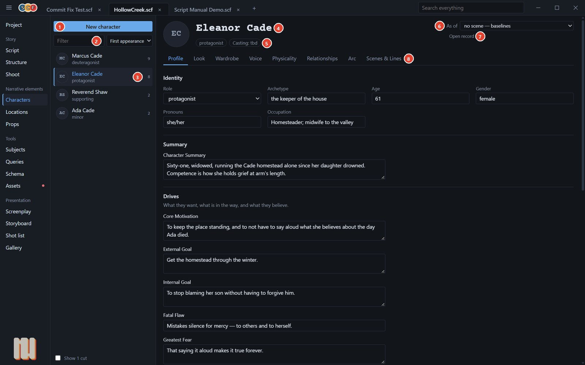

| | Part | |
|---|---|---|
| ① | **New character** | Make a character |
| ② | **Filter** and order | Narrow and sort the rail |
| ③ | **A character** | Click to open them |
| ④ | **Name** | Edit it in place |
| ⑤ | **Chips** | Role, casting status and variants |
| ⑥ | **As of** | Show them as they are in a given scene |
| ⑦ | **Open record** | The plain form with every field |
| ⑧ | **Tabs** | Profile, Look, Wardrobe, Voice, Physicality, Relationships, Arc, Scenes & Lines |

## The rail

The list on the left is every character in the film.

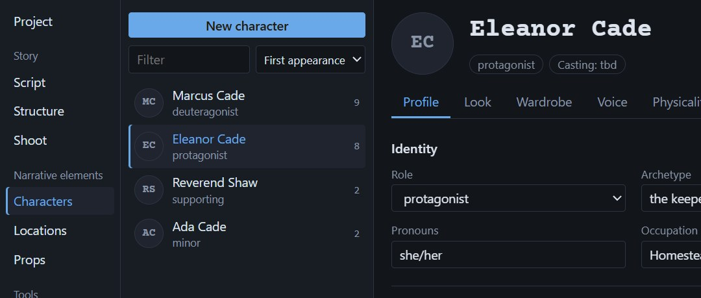

- Each entry shows a **face** (their reference image, cropped to the face
  you've marked, or their initials), their **name**, their **role**, and
  how many scenes they're in.
- **Filter** narrows the list by name.
- The order menu sorts by **First appearance** (the default), **Most
  used** or **A–Z**.
- Cut characters are hidden. Tick **Show 1 cut** at the bottom to see
  them.

### Making a character

**New character** asks for a name, and that's all. **Create** makes the
character and opens their Profile. If the name is already taken, the
editor offers to open the existing one instead, or make another anyway.

Most characters arrive from the script instead: a new name in a cue
becomes a character when you [commit](editor-script.html).

### Renaming and deleting

- **Rename** by editing the name at the top of the workspace. It saves
  as you type, and every scene and line keeps pointing at them.
- **Delete** from **Open record**, then **Delete**. It asks first. To
  take someone out of the film without losing their work, set their
  lifecycle to **cut** in the record instead.

## The header

At the top of every character:

- **Face and name**: the name is editable.
- **Chips**: their role, casting status, and any variants.
- **As of**: see below.
- **Open record**: the plain form with every field, for anything the
  tabs don't show.

Every field in the workspace saves itself. Removing something inside a
tab (a costume, a habit, a link) doesn't ask first; the undo toast at
the bottom brings it back.

### As of: the character at a point in the story

The **As of** menu is the most important control here. It picks a scene,
and every tab then shows the character **as they are in that scene**:

- the reference images in force there
- the costume they're wearing
- the voice or physical shifts that apply
- the stage each relationship has reached

With **no scene — baselines** picked, you see the baselines: how the
character is when nothing has changed them. Scenes the character
appears in are marked **●** in the menu.

Here's Eleanor's Look board **as of scene 12** ①. A note ② says the
board is showing what's in force there, and each file that applies has
an **in force** badge ③. Files that don't apply are dimmed.

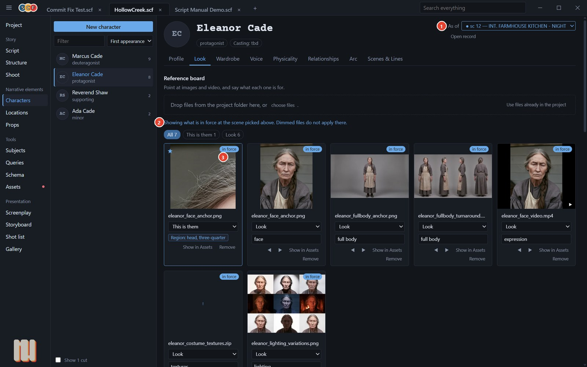

The choice stays when you switch characters, so you can step through
the cast at one moment in the film.

## Profile

Who they are, in four sections:

- **Identity**: role (protagonist, deuteragonist, supporting, minor…),
  archetype, age, gender, pronouns, occupation.
- **Summary**: a paragraph about them.
- **Drives**: core motivation, external goal, internal goal, fatal flaw,
  greatest fear, core belief.
- **History**: backstory, education, skills and abilities.

Further down:

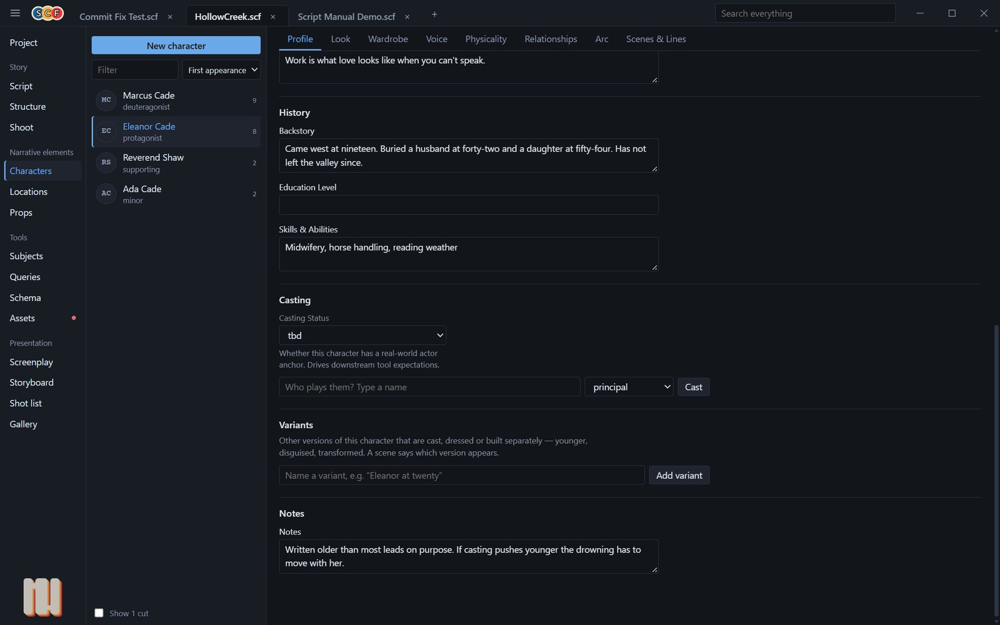

- **Casting**: a casting status, then one row per performer. Type a name
  in **Who plays them?**, choose how (principal, body double, stunt double, voice double, ADR…),
  and press **Cast**.
- **Variants**: other versions of the character that are cast, dressed or
  built separately: younger, disguised, transformed. Name one with **Add
  variant**, then describe how it differs. A scene can then say which
  version appears.
- **Notes**.

## Look

### The reference board

The Look tab opens with the character's **reference board**: the images
and video that say what they look like.

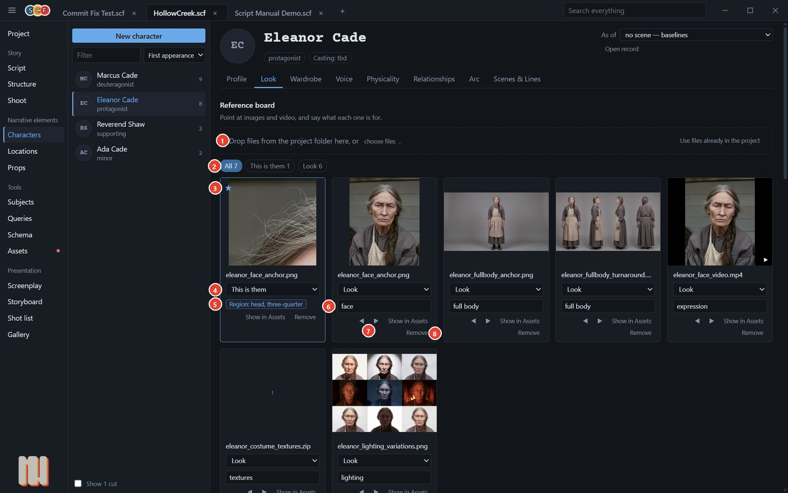

To add files, drop them onto the board ① from the project folder, click
**choose files**, or use **Use files already in the project**. The
editor then asks what each one is for:

| Purpose | Meaning |
|---|---|
| **This is them** | Their face. Tools downstream match against it. |
| **Look** | Hair, costume, makeup, a turnaround: how they look. |
| **Concept** | Design exploration. It informs, but isn't the answer. |
| **Inspiration** | Mood and tone from elsewhere. |

Each tile has:

- ④ a **purpose** menu
- ⑥ a **role** note, such as "front", "full body" or "turnaround"
- ⑦ **◀ ▶** to reorder
- ⑧ **Show in Assets** and **Remove**

**This is them** tiles have more:

- ③ **★** marks the main reference.
- **Confirm** appears on one that's proposed but not confirmed yet.
  Tools ignore an unconfirmed identity image.
- **Mark the face** lets you drag a box over the face. The rail and other
  tools then crop to it. The region you marked shows on the tile ⑤.

The chips above the board ② (**All 7**, **This is them 1**, **Look 6**)
filter by purpose. **hide historic** hides older versions without
removing them.

If the same set of images is shared with another character (twins, or a
character and their variant), adding to it asks whether to change it for
everyone or give this one its own copy.

### Exceptions

Under the board, **Exceptions** say where something other than the
baseline applies. **Add an exception**, then choose when it applies:

- **In certain scenes** (from one scene until another)
- **While in a physical state** (wounded, exhausted…)
- **While in a vocal state** (hoarse…)
- **As a variant** (for example "Eleanor at twenty")

Then drop the files that apply there. Tick **Replaces the baseline
there** if they should replace the usual images rather than add to them.

When more than one exception applies, the one higher in the list wins.
Use the arrows to reorder. With **As of** set, each card says **in force
here** or **not here**.

### Appearance and colour

Below the board are the written details. **Appearance** covers body and
features, skin and grooming, design, and how it changes. **Color
identity** gives the character a palette and says how it shifts through
the story.

## Wardrobe

### Costumes

Each costume is a card. Click its name to open it.

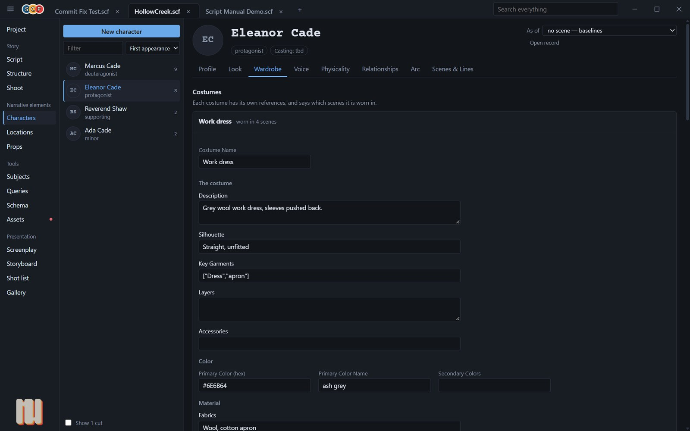

A costume has:

- **The costume**: description, silhouette, key garments, layers,
  accessories.
- **Color**, **Material**, **What it says**, and **Continuity**
  (continuity notes, such as "creek-soaked from sc 9").
- **Worn in**: the scenes it's worn in ①. Add one with **+ scene** ②;
  remove one with its **×**.
- **References**: the costume's own board, with its own exceptions.

Add a costume by naming it ("mourning dress") and pressing **Add
costume**. With **As of** set, the costume worn in that scene is marked
**worn here** ③.

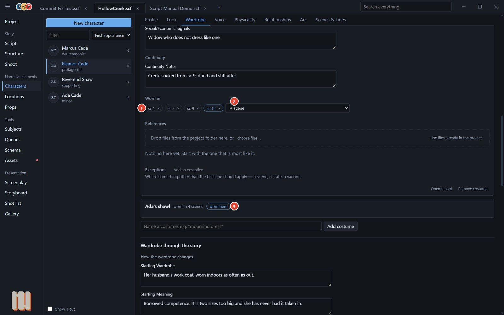

### Wardrobe through the story

Below the costumes are notes on how the wardrobe changes (starting
wardrobe and what it means, and how colour, formality and condition
evolve), then a [story strip](#story-strips). Click a scene in the
**Wardrobe stages** row to start a stage there, such as "soaked" or
"mended".

### Makeup and hair

A baseline (makeup, hair, and effects such as prosthetics, ageing and
injuries), then **Scenes that differ**. Use **+ a scene where it
differs** to note what's different in that scene.

## Voice

- **Voice reference**: a board for recordings. **This is their voice**
  is their identity recording; **Mark the clip** chooses the exact
  stretch of it to use.
- **The voice**: quality, pitch range, timbre, volume, breathiness,
  speech pattern, pace, rhythm, accent, delivery, habits.
- **Shifts**: where the voice changes from the baseline, in story order.
  Each one says whether it lasts one scene, until another scene, or
  until it's resolved. **New vocal shift** starts one, already filled in
  with the scene picked in **As of**.
- **Voiceover**: any voiceover the character has.

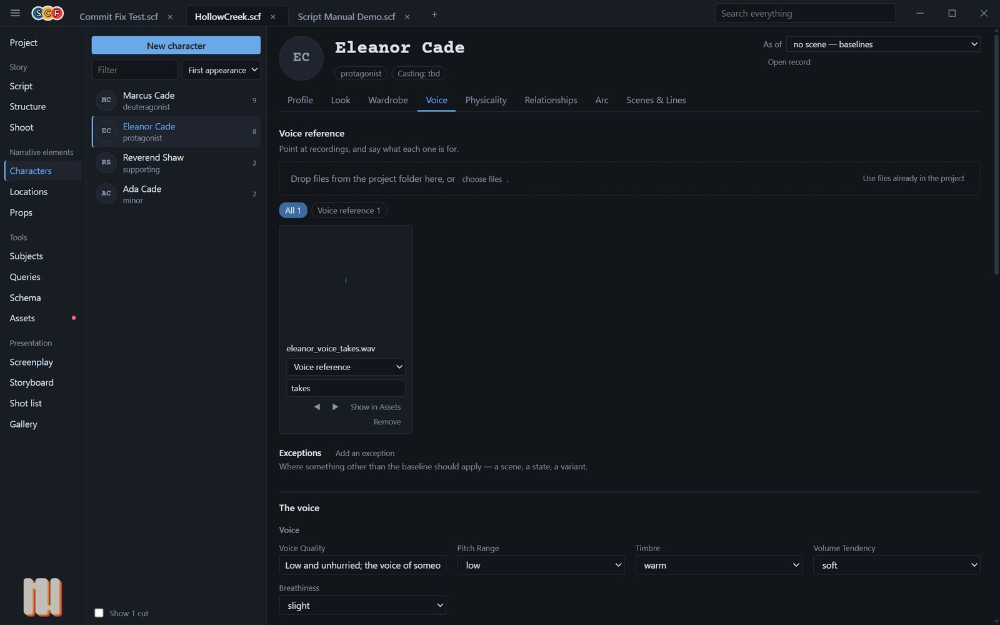

## Physicality

Built like Voice:

- **Motion reference**: video of how they move.
- **The body**: posture and energy, movement, face, presence, how
  emotion shows, what the body carries.
- **Habits**: small repeated actions. "Wipes dry hands on her apron."
- **Shifts**: physical changes through the story (a wound, a limp).
  These are the physical states that exceptions can use.
- **In particular places**: how they are in a given location. At home,
  on guard, out of place.

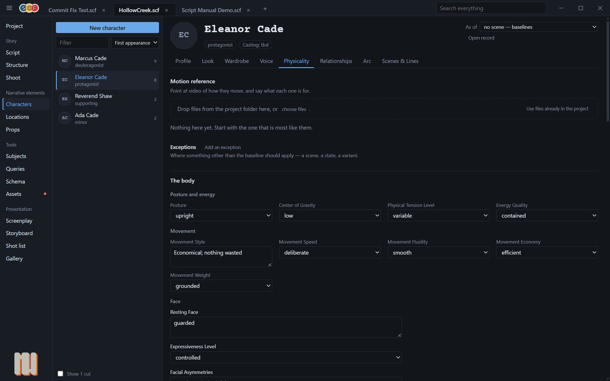

## Relationships

The map shows the character in the middle and everyone else around them.

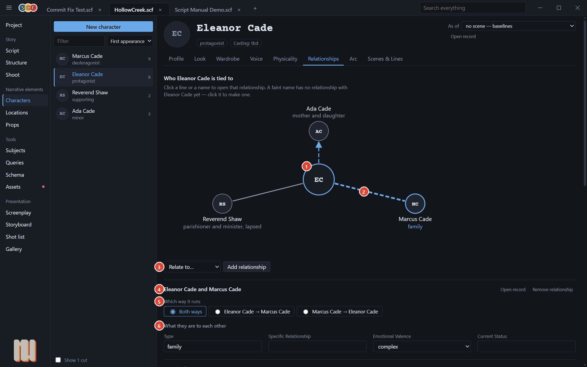

- ① The character sits in the middle.
- ② A **line** is a relationship. Its colour and style show how it feels
  (positive, negative, complex or neutral). An arrow means it runs one
  way.
- A **faint name** has no relationship with this character yet. Click it
  to make one.
- ③ **Relate to…** and **Add relationship** do the same from a menu, and
  can make a new character on the spot.

Click a line or name to edit that relationship below the map ④:

- ⑤ **Which way it runs**: both ways, or one way.
- ⑥ **What they are to each other**: type (family, romantic…), the
  specific relationship, its emotional valence and current status.
- **How it changes**: a story strip. Click a scene in **Stages** to mark
  where the relationship turns.
- **Dynamic**, **Physically** (touch, distance, eye contact…) and
  **History**.

## Arc

How the character changes over the film.

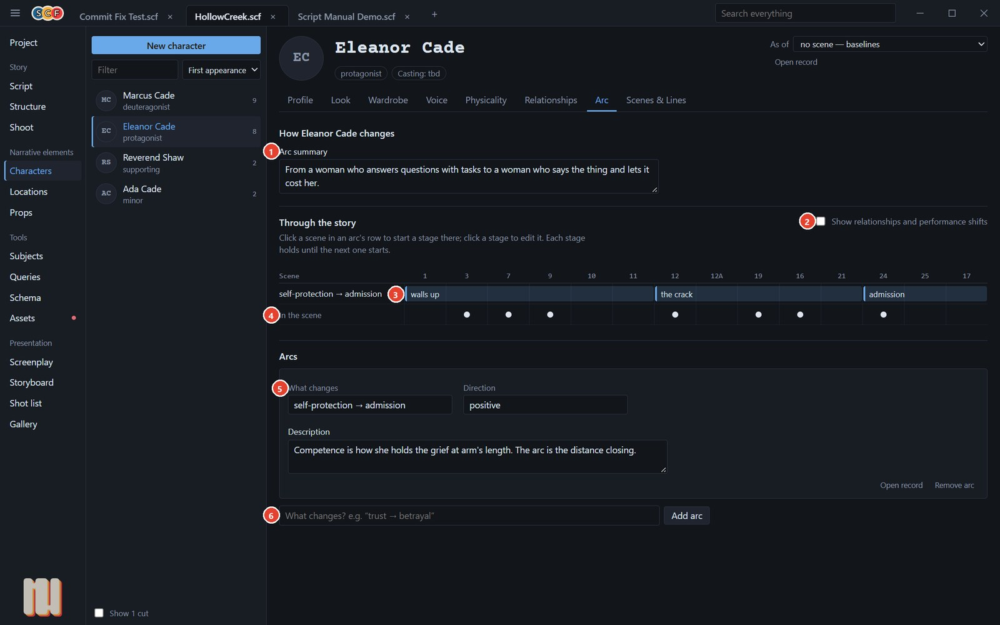

- ① **Arc summary**: the change in a sentence.
- **Through the story**: a story strip with a row for each arc. Click a
  scene in an arc's row to start a stage there ③, as Eleanor's *walls up
  → the crack → admission*. The **In the scene** row ④ shows where she
  appears.
- ② **Show relationships and performance shifts** adds read-only rows
  for each relationship and each voice or physical shift, so you can see
  everything that moves at once.
- ⑤ **Arcs**: each arc says what changes ("self-protection →
  admission"), its direction and a description. Add one with **Add arc**
  ⑥.

## Scenes & Lines

Where the character is, and what they say.

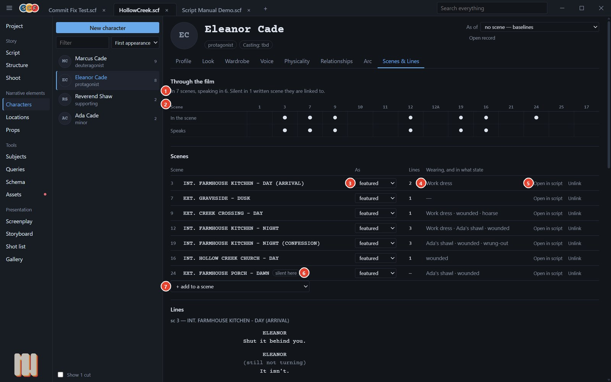

**Through the film** sums it up ①: *In 7 scenes, speaking in 6. Silent
in 1 written scene they are linked to.* The strip ② shows where they're
present and where they speak.

The **Scenes** table has a row per scene:

- ③ **As**: how they're in it: featured, supporting, background,
  mentioned or voiceover.
- **Version**: which variant appears, if they have variants.
- **Lines**: how many lines they speak there.
- ④ **Wearing, and in what state**: the costume and states in force.
- ⑤ **Open in script** jumps to the scene. **Unlink** takes them out of
  it.

Two flags help keep the cast honest:

- **speaks, not linked**: they have lines in a scene they aren't linked
  to. Click **Link to scene** to fix it.
- ⑥ **silent here**: they're linked to a scene but say nothing. That's
  often right (Eleanor on the porch at dawn), but worth a glance.

⑦ **+ add to a scene** links them to another scene.

Below the table:

- **Lines**: every line they speak, by scene. Click one to open the
  script there.
- **Shots** they're framed in.
- **Things they carry**: props they own or hold.
- **What they stand for**: themes and motifs they carry.

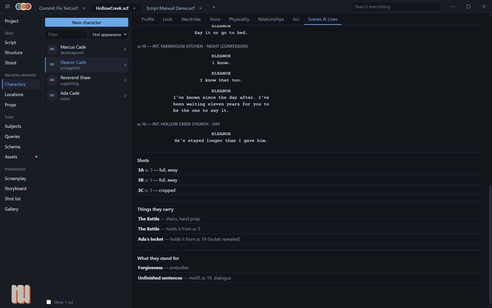

## Story strips

Several tabs use the same grid, called a **story strip**. Scenes run
across the top in story order, and each row is one thing that changes.

- **Stage rows** (Wardrobe stages, an arc, a relationship's Stages) are
  editable. Click a scene to start a stage there, give it a short label,
  and press **Add stage**. **A stage holds until the next one starts.**
  Click a stage to edit it, move its start, or remove it.
- **Dot rows** (In the scene, Speaks) are read-only. A solid dot is a
  strong presence, a faint one a weak presence.
- With **As of** set, that scene is highlighted down the whole strip.

Problems are listed under the strip, such as a stage starting at a scene
the film no longer has.

## Tips

- **Start with Profile and the face.** A confirmed **This is them** image
  with its face marked does more for downstream tools than anything
  else.
- **Use As of to check continuity.** Step through a character's scenes
  and watch the wardrobe and references change.
- **Shifts and exceptions work together.** Make a physical shift
  ("wounded"), then add a Look exception **While in a physical state**,
  and the right images apply wherever the wound does.
- **Clear the "speaks, not linked" flags.** Each one is a scene where a
  tool would otherwise not know the character is there.
