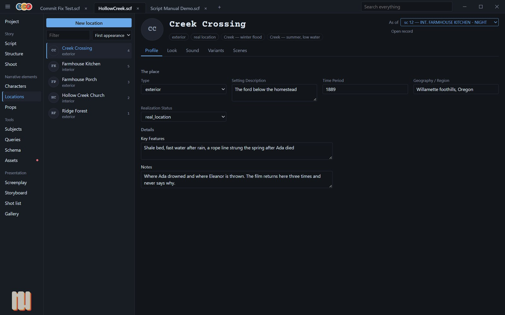
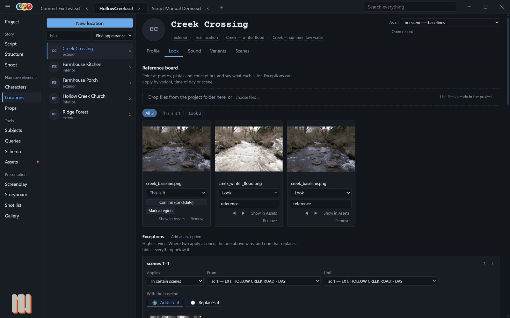
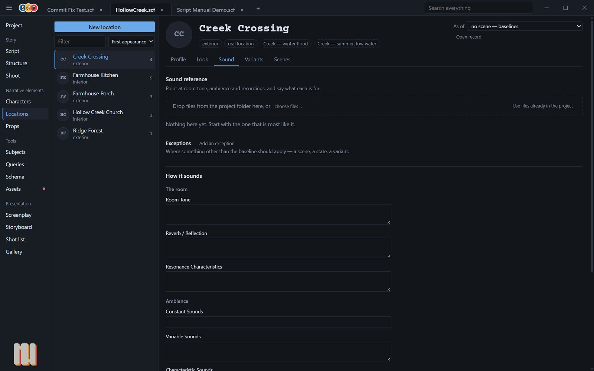
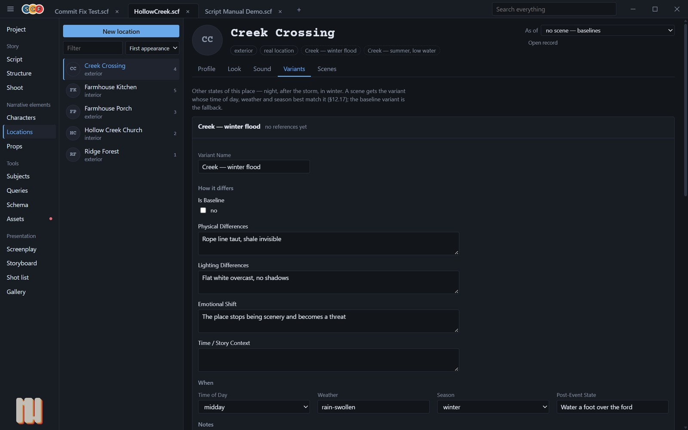
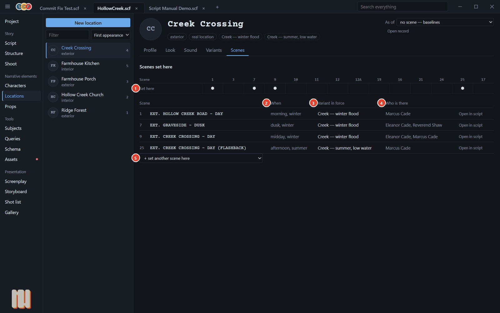
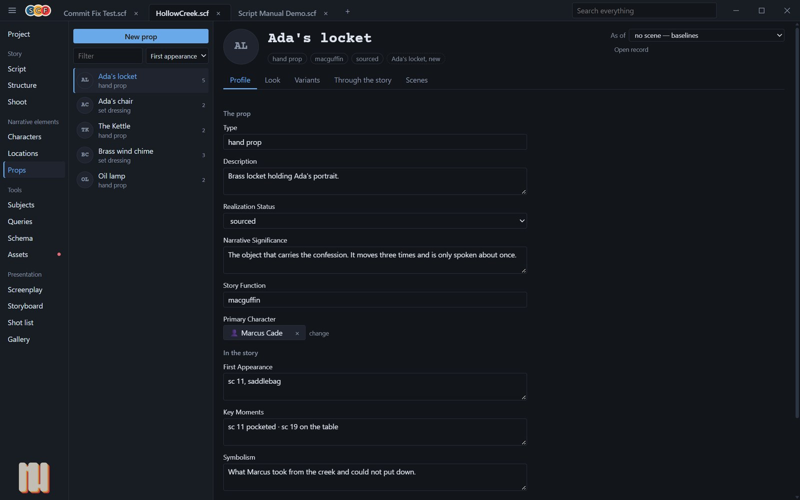
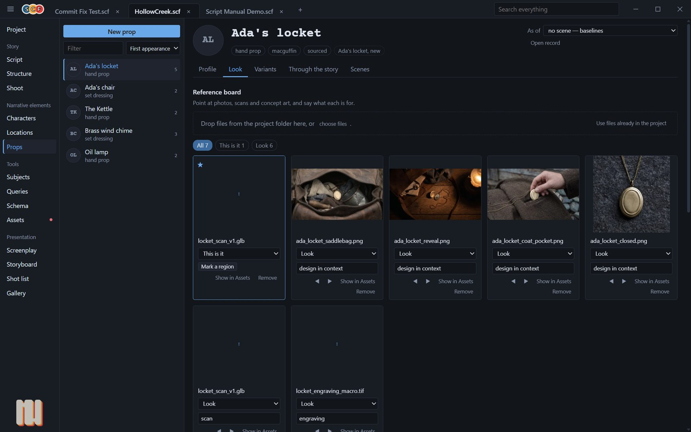
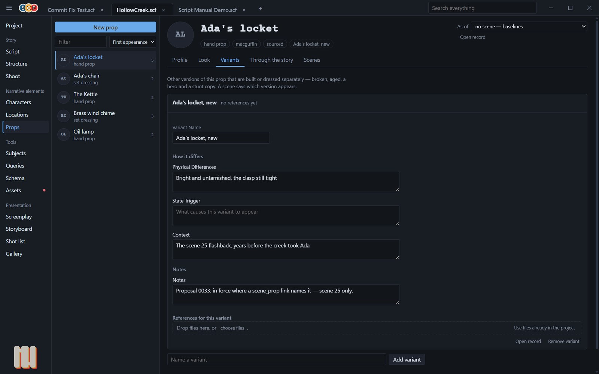
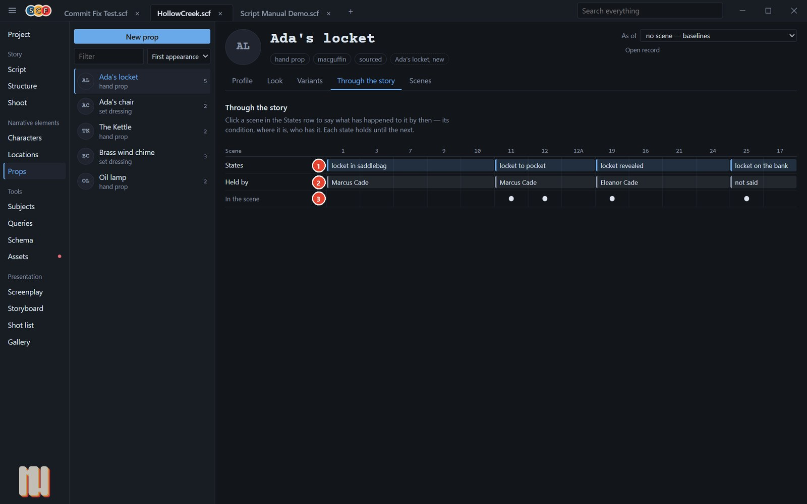
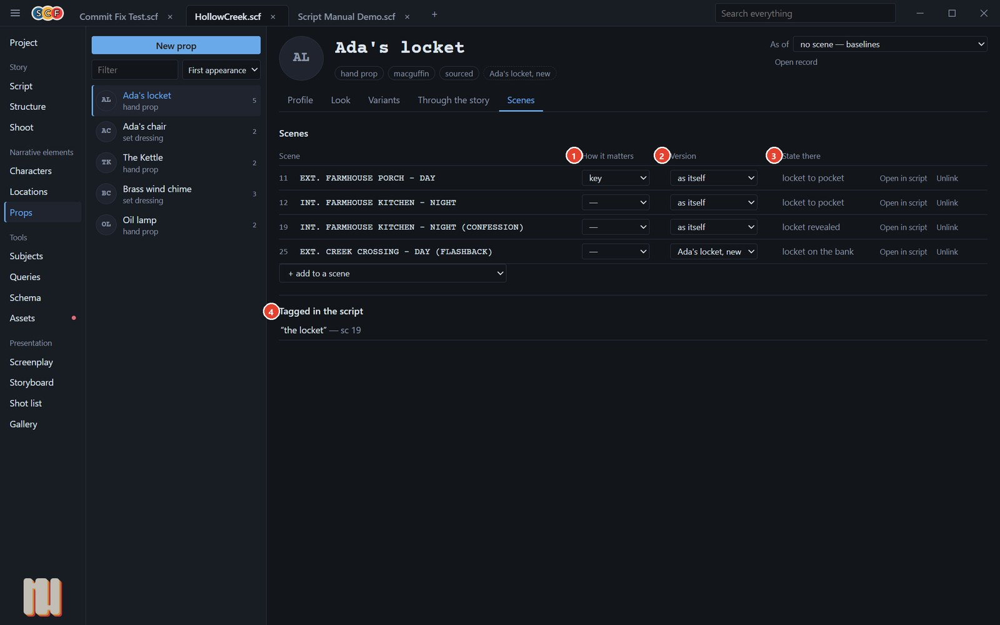

<!-- SPDX-License-Identifier: CC-BY-4.0 -->
# The Locations and Props tabs

Locations and props get the same kind of workspace as characters, with
fewer tabs. The rail, the **As of** menu, reference boards, exceptions
and story strips all work as described on the
[Characters page](editor-characters.html), so this page covers only
what's different.

## Shared ground

- **The rail** lists every location or prop. Each shows its type
  (exterior, hand prop, set dressing…) and how many scenes it's in.
  Filter and sort it as you would characters.
- **New location** and **New prop** ask for a name. Locations also
  arrive from scene headings on commit. Props arrive when you
  [tag them in the script](editor-script.html).
- **The header** shows chips for the type, realization status, and each
  variant, plus **As of** and **Open record**.
- **Look boards** use **This is it** where a character's uses **This is
  them**, with **Mark a region** in place of **Mark the face**.
- Fields save themselves, and removals can be undone from the toast.

# Locations

A location has five tabs: **Profile, Look, Sound, Variants, Scenes**.

## Profile

- **The place**: type (interior, exterior…), setting description, time
  period, geography or region, and **Realization Status**. That's how
  the place will be made: a real location, a built set, a captured
  plate, a virtual set, a hybrid, or generated only.
- **Details**: key features and notes.

## Look

The reference board for the place: photos, plates and concept art.
Then **Design** (concept, architecture, materials, space, light) and
**Color** (palette).

Location exceptions can apply **in certain scenes**, **as a variant**,
or **at a time of day**. So night plates can apply to every night
scene without listing them.

## Sound

What the place sounds like. **Sound reference** is a board for room tone,
ambience and recordings. **How it sounds** covers the room (room tone,
reverb, resonance) and its ambience (constant, variable and
characteristic sounds).

## Variants

Other states of the same place: night, after the storm, in winter.

Each variant has:

- **How it differs**: physical, lighting and emotional differences.
- **When**: time of day, weather, season, and the state the place is in
  after an event ("Water a foot over the ford").
- **Is Baseline**: tick one variant as the fallback.
- **References for this variant**: its own images. Adding the first one
  makes the variant's images replace the baseline's wherever it applies.

**A scene picks its variant for you.** The editor matches the scene's
time of day, weather and season against each variant, and uses the best
match. If nothing matches, it uses the baseline variant. You don't have
to assign variants scene by scene.

## Scenes

**Scenes set here** shows a strip of where the place appears ①, then a
table:

| | Column | What it shows |
|---|---|---|
| | **Scene** | Number and heading |
| ② | **When** | The scene's time of day, weather and season |
| ③ | **Variant in force** | The variant the editor picked for it |
| ④ | **Who is there** | The characters in the scene |

**Open in script** jumps to the scene. ⑤ **+ set another scene here**
moves another scene to this location.

In Hollow Creek, the winter scenes get **Creek — winter flood**, and the
summer flashback gets **Creek — summer, low water**, with no one
choosing either by hand.

# Props

A prop has five tabs: **Profile, Look, Variants, Through the story,
Scenes**.

## Profile

- **The prop**: type (hand prop, set dressing…), description,
  realization status, narrative significance, story function (functional, MacGuffin,
  symbol, plot device…), and its **Primary Character**: whose it is.
- **In the story**: first appearance, key moments, symbolism.
- **Notes**.

## Look

The prop's reference board (photos, scans, concept art and 3D models),
then **Surface**: material and size, colour, surface, condition, and
what makes it *this* one.

## Variants

Other versions of the prop that are built or dressed separately:
broken, aged, a hero copy and a stunt copy. Unlike locations, **a scene
says which version appears**. Pick it in the **Version** column on the
Scenes tab.

## Through the story

Where the prop is and what's happened to it, scene by scene.

- ① **States** is editable. Click a scene to say what has happened to it
  by then: its condition, where it is, who has it. Each state holds
  until the next one.
- ② **Held by** shows who has it.
- ③ **In the scene** marks the scenes it's linked to.

For the locket: *locket in saddlebag* (Marcus) → *locket to pocket*
(Marcus) → *locket revealed* (Eleanor) → *locket on the bank*.

## Scenes

The table lists each scene the prop is linked to:

| | Column | What it shows |
|---|---|---|
| ① | **How it matters** | Its significance there: key, present, background or mentioned |
| ② | **Version** | *as itself*, or a variant |
| ③ | **State there** | The state in force from Through the story |

Use **Open in script** to jump there, or **Unlink** to remove it.
**+ add to a scene** adds a link.

④ **Tagged in the script** lists every place the prop's words are tagged in
the screenplay, such as *"the locket" — sc 19*. Tag more by selecting
words in the Script tab and using **tag prop**.

## Tips

- **Give locations a time of day and season in their scenes.** It's what
  lets variants pick themselves.
- **Mark a baseline variant.** Without one, a scene that matches nothing
  falls back to the plain Look board.
- **Track hero props with states.** A prop that changes hands or
  condition is a continuity risk. The States row makes its history easy
  to check.
- **Tag props in the script** for the moments that matter. A tag ties
  the prop to the exact words, so it follows them through rewrites.
