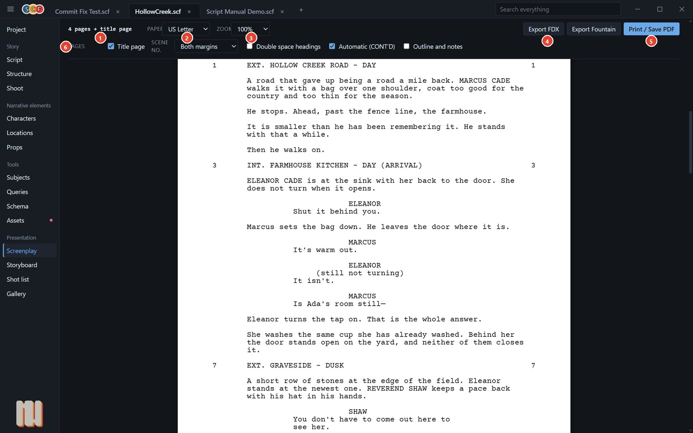
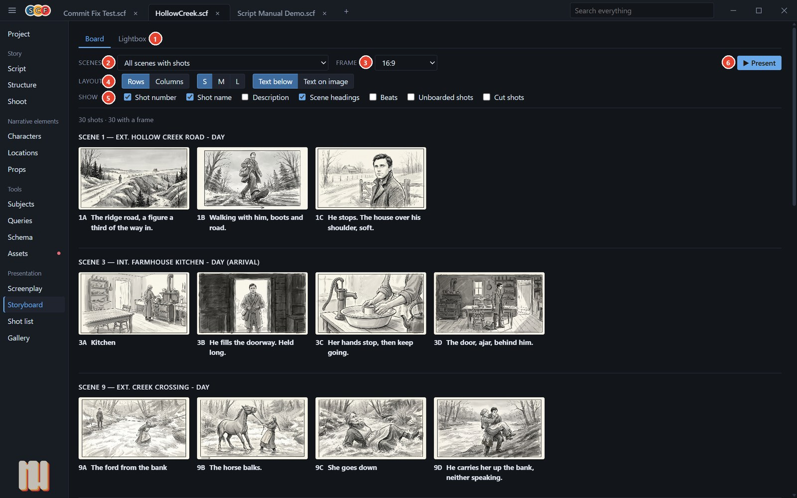
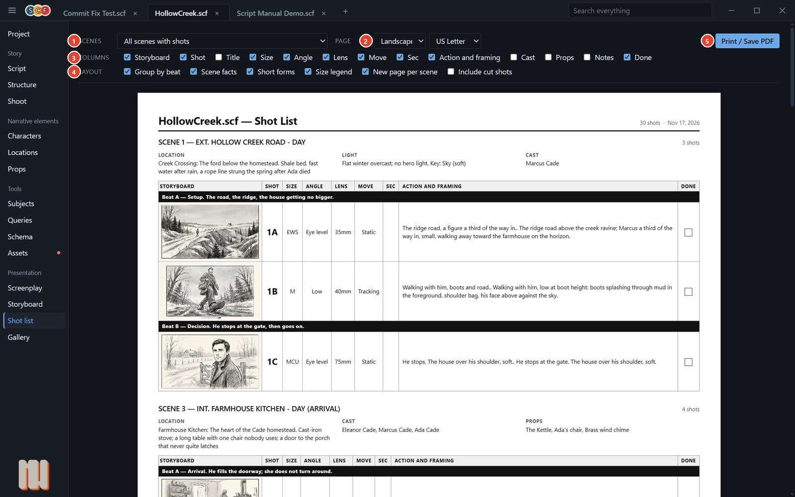
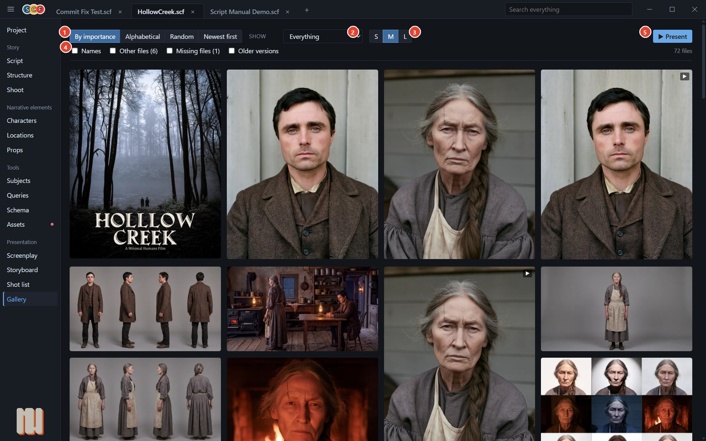

<!-- SPDX-License-Identifier: CC-BY-4.0 -->
# The Presentation tabs

The four Presentation tabs turn the project into something to read,
print, or show a room. None of them change the file. They're views of
what's already there.

| Tab | Shows | Out |
|---|---|---|
| **Screenplay** | The script as printed pages | Print / PDF, Final Draft (FDX), Fountain |
| **Storyboard** | Every shot by its storyboard frame | Present full screen |
| **Shot list** | The shot plan as a paper list | Print / PDF |
| **Gallery** | Every image in the project | Present full screen |

Your choices on each tab are remembered.

## Screenplay

The committed script, laid out the way Final Draft pages it: Courier 12,
standard margins, (MORE) and (CONT'D) across page breaks, and the title
page from the [Project tab](editor-project.html#title-page).

It shows the **last commit**, so commit the Script tab first if you've
been writing.

**Toolbar**

- ① The page count: *4 pages + title page*.
- ② **Paper**: US Letter or A4.
- ③ **Zoom**: on screen only, so it doesn't affect printing.
- ④ **Export FDX** and **Export Fountain** save the script with its
  title page, named after the project.
- ⑤ **Print / Save PDF** opens the print dialog. For a PDF, choose **Save
  as PDF** and set margins to **None**; the page already has its own.

**Pages** ⑥

- **Title page**: include it or not.
- **Scene no.**: numbers in both margins, the left margin only, or none.
- **Double space headings**: two blank lines before each scene heading.
- **Automatic (CONT'D)**: add CONT'D when a character speaks again after
  action.
- **Outline and notes**: show act and sequence lines, synopses and notes.
  Off by default, as on a printed script.

## Storyboard

Every shot, shown by its first storyboard panel (or its start frame),
grouped by scene.

There are two views ①. **Board** has captions and layout options;
**Lightbox** is a plain contact sheet.

| | Control | What it does |
|---|---|---|
| ② | **Scenes** | All scenes with shots, or just one |
| ③ | **Frame** | The frame shape: the project's aspect ratio, or 16:9, 1.85:1, 2.39:1, 4:3, 1:1, 9:16 |
| ④ | **Layout** | **Rows** or **Columns**; frame size **S / M / L**; captions **below** or **on** the image |
| ⑤ | **Show** | Shot number, shot name, description, scene headings, beats, shots with no frame yet, cut shots |

⑥ **▶ Present** (or clicking a frame) shows the boards one at a time:

- **←/→**, **Space** or **Page Up/Down** to step
- **Home** and **End** for the first and last
- **F** for full screen
- **Esc** to close

The frames come from the Shoot tab's [media](editor-shoot.html#media).
A shot with no storyboard or start frame shows as a blank, or is hidden
if you untick **Unboarded shots**.

## Shot list

The Shoot tab's plan, printed: one table per scene, with the storyboard
frame beside each shot.

- ① **Scenes**: all of them, or one.
- ② **Page**: landscape or portrait, US Letter or A4.
- ③ **Columns**: storyboard, shot, title, size, angle, lens, move,
  seconds, action and framing, cast, props, notes, and a **Done** box
  for ticking off on the day.
- ④ **Layout**:
  - **Group by beat** puts beat headings between shots.
  - **Scene facts** adds the location, light, cast and props above each
    scene.
  - **Short forms** writes ECU, MCU and so on.
  - **Size legend** explains those short forms.
  - **New page per scene**.
  - **Include cut shots** (off by default) adds them, marked *cut*.
- ⑤ **Print / Save PDF**, as on the Screenplay tab.

The header gives the project, shot count, running time (from each shot's
estimated duration) and today's date.

## Gallery

Every image in the project on one wall. Use it for pitching, for mood,
or to spot the files nothing uses.

- ① **Sort**: **By importance** (the most-used files first),
  **Alphabetical**, **Random** (click again to reshuffle) or **Newest
  first**.
- ② **Show**: everything, or only characters, locations, props, shots and
  scenes, or **Not used by anything**.
- ③ **S / M / L** sets the tile size.
- ④ **Names**, **Other files** (audio, scans, archives), **Missing files**
  and **Older versions** add those to the wall.
- Hover a tile to see what uses it.
- ⑤ **▶ Present** works as on the Storyboard tab, with each file's
  description and what uses it.

The gallery needs the [project folder](editor-project.html#project-folder)
to show pictures.

## Tips

- **Commit before you print.** The Screenplay tab shows the last commit,
  not what's on screen in the Script tab.
- **Fill in the title page once.** It's used by the printed page and both
  exports.
- **Use Present for reviews.** The storyboard viewer is a quick animatic
  for walking someone through a scene.
- **Check "Not used by anything"** in the gallery before handing a
  project over. It finds files that were imported and forgotten.
