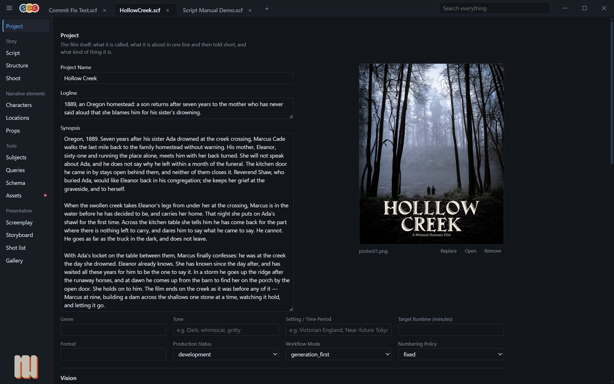
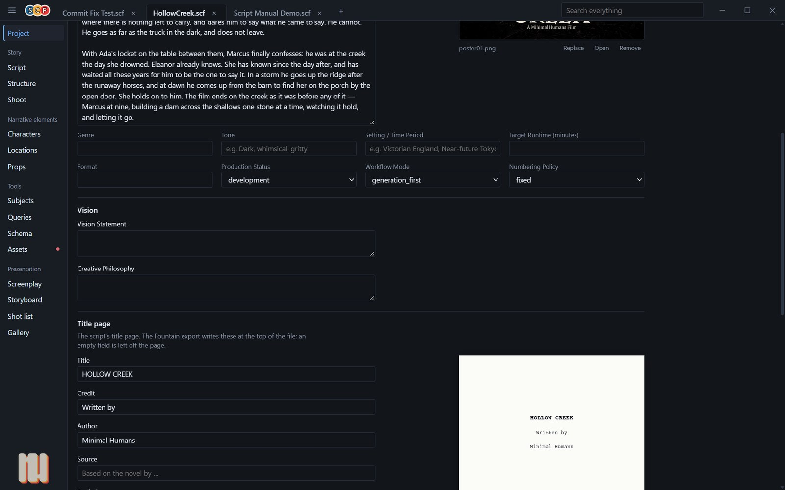
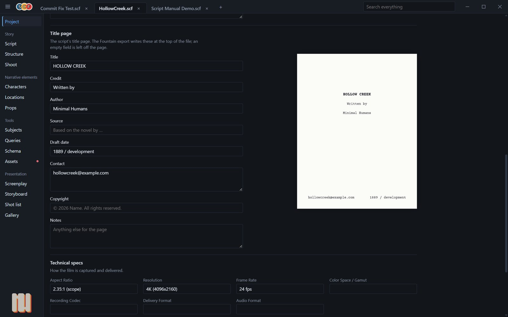
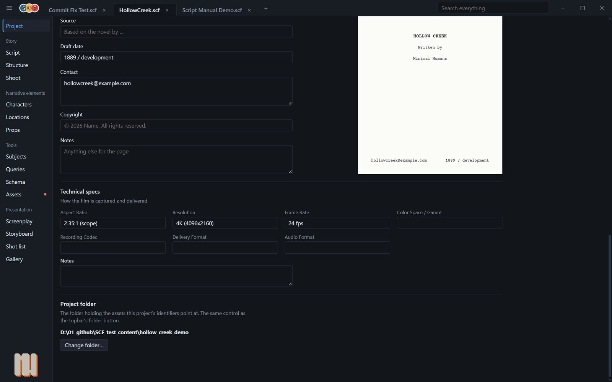
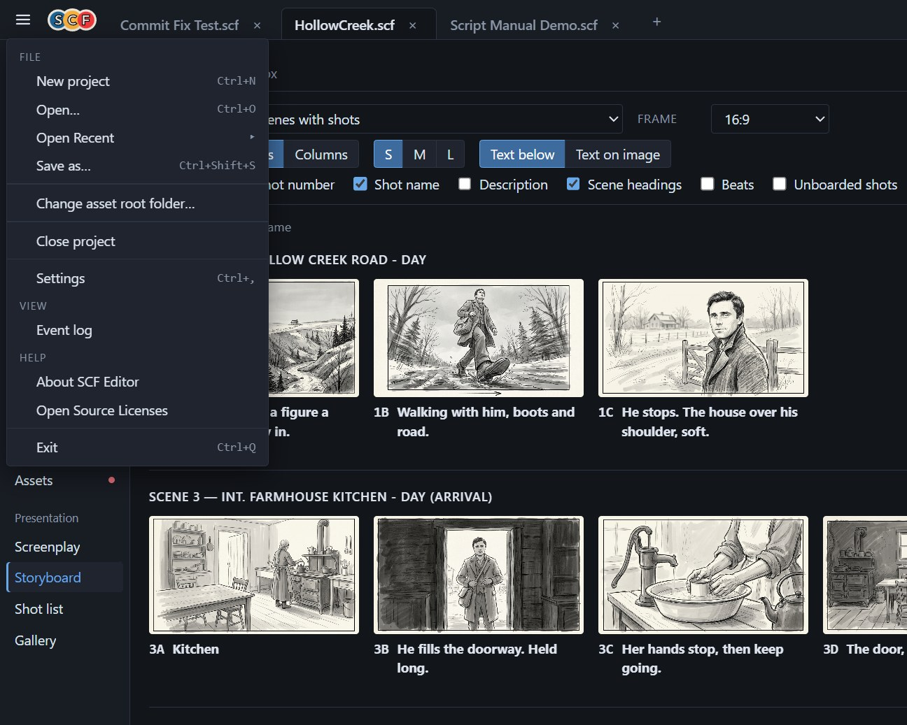

<!-- SPDX-License-Identifier: CC-BY-4.0 -->
# The Project tab and the editor around it

The Project tab is the film's front page. It holds:

- the film's name, logline and synopsis
- its poster
- the creative intent behind it
- the script's title page
- the technical specs
- the folder where its media lives

This page also covers what surrounds every tab: the file tabs, the app
menu, search, settings, and how the editor saves your work.

## How saving works

**There is no Save button.** Every change is written to the `.scf` file
as you make it:

- **Text fields** save about a second after you stop typing, and when
  you click away. Leaving a tab halfway through a sentence still keeps
  what you typed.
- **Dropdowns and checkboxes** save the moment you change them.
- **Record forms** (the full editor opened by **Open record** or **⋯**)
  are the one exception. They keep a draft until you press **Save
  changes**. While a draft is waiting, the file's tab shows a dot.
- **The Script tab** saves your text as you type too. Its **Commit**
  button is a separate step, for turning new headings and names into
  records. The [Script manual](editor-script.html) explains it.

Because nothing is ever unsaved, closing a file never asks whether to
save. To keep a version before a big change, use **Save as…**
(Ctrl+Shift+S). It writes a copy and switches you to it, leaving the
original as it was. The suggested name counts up for you:
`hollow_creek.scf` becomes `hollow_creek_v2.scf`, then `_v3`.

### Undo

Deleting something, or another change the editor records, shows a toast
at the bottom of the window with **Undo**. Most removals don't ask
first, so this toast is your way back.

## The Project tab

The tab is one long page in five sections. Every field saves itself.

### Project

**Project Name**, **Logline** and **Synopsis** are the film in a word, a
line and a page. Tools that read the file, including Claude over MCP,
start here.

**The poster** sits to the right:

- With no poster, the box takes a file. Drop one from the project
  folder, or click to choose one.
- With a poster, three buttons sit under it:
  - **Replace** takes a new file. The old one is kept as an alternative.
  - **Open** shows the file in Assets.
  - **Remove** takes it off the project. The file itself stays.
- If the project folder isn't connected, you'll see **Connect folder**
  in place of the picture.

Below them is a grid of short fields:

| Field | What it holds |
|---|---|
| **Genre** | drama, comedy, thriller, sci-fi, fantasy, horror… |
| **Tone** | Free text: "dark, whimsical, gritty" |
| **Setting / Time Period** | Free text: "Oregon, 1889" |
| **Target Runtime (minutes)** | A number |
| **Format** | feature, series, short, commercial |
| **Production Status** | development → pre_production → production → post_production → complete |
| **Workflow Mode** | performance_first, generation_first or hybrid: whether the film is shot, generated, or both |
| **Numbering Policy** | **derived** or **fixed**. See below. |

### Numbering policy

This one setting decides who owns scene and shot numbers:

- **Derived:** the editor numbers everything. Scenes are 1, 2, 3… in
  script order. Shot codes follow their scene, and acts and sequences
  are renumbered when you change the structure. Good while you're still
  writing.
- **Fixed:** numbers are frozen. A scene you move keeps its number. A
  scene you add has no number until you give it one (12A, A12…). Use
  this once numbers are on schedules, call sheets or shot lists.

Changing it always opens a confirmation first:

- **Switching to fixed** asks "Freeze all numbering?"
- **Switching to derived** counts what the next commit would change
  (for example "renumber 9 scenes of 15, rewrite 22 shot codes") and
  asks "Let the editor renumber everything?" Lettered numbers like 12A
  are lost.

Neither direction can be undone, so **Save as…** a copy first if
numbers are already in use. Hollow Creek is set to **fixed**, which is
why its scenes run 1, 3, 7, 9…

### Vision

**Vision Statement** and **Creative Philosophy**: what the film is for,
and how it should feel to make. These are free text, read by people and
by assistants writing prompts.

### Title page

These fields print at the top of the screenplay and are written into
Fountain and FDX exports. An empty field is left off the page.

| Field | Example |
|---|---|
| **Title** | HOLLOW CREEK |
| **Credit** | Written by |
| **Author** | Minimal Humans |
| **Source** | Based on the novel by … |
| **Draft date** | 1889 / development |
| **Contact** | Name, agency, phone, email (several lines) |
| **Copyright** | © 2026 Name. All rights reserved. |
| **Notes** | Anything else for the page |

The preview on the right shows roughly how the page will print. Title,
credit, author and source sit in the middle. Contact and copyright go
bottom left; draft date and notes go bottom right.

If **Title** is empty, a button offers to use the project name. Extra
title-page keys that came in with an imported script are listed under
the eight fields and kept.

### Technical specs

How the film is captured and delivered:

- **Aspect Ratio**, **Resolution** and **Frame Rate** are dropdowns of
  the usual values.
- **Color Space / Gamut**, **Recording Codec**, **Delivery Format**,
  **Audio Format** and **Notes** are free text.

The Storyboard tab can use the aspect ratio for its frames.

### Project folder

A `.scf` file doesn't contain your images, video or sound. It points at
them with identifiers like `@project/assets/locations/creek.png`. The
**project folder** is the folder those identifiers start from.

- **Choose folder…** or **Change folder…** sets it.
- If the folder can't be found (a moved folder, or an unplugged drive),
  the path shows in red with "not found".

The folder pairing is remembered on this computer, not stored in the
`.scf` file. So a collaborator can keep the media somewhere else on
their machine and point the same file at it.

## Around every tab

### File tabs

Each open `.scf` file gets a tab across the top. You can have several
open at once.

- **+** opens another file. Close a tab with its **×** or a middle-click.
- Drag tabs to reorder them.
- A tab shows a marker when something needs attention: **⚠** for a lost
  connection or a missing project folder, **●** for a file changed by
  another program, or a record form with an unsaved draft. Hover the
  tab to see why.
- If another program (Claude over MCP, for example) edits the open
  file, an "edited by…" pill appears in the title bar.
- If a file changes on disk outside the editor, your edits are refused
  until you click **Reload**, so nothing gets overwritten.

### The section list

The column on the left switches between the tabs:

| Group | Tabs | Shortcuts |
|---|---|---|
| — | Project | |
| Story | Script, Structure, Shoot | Alt+1, Alt+2, Alt+3 |
| Narrative elements | Characters, Locations, Props | Alt+4, Alt+5, Alt+6 |
| Tools | Subjects, Queries, Schema, Assets | Alt+7, Alt+8, Alt+9, Alt+0 |
| Presentation | Screenplay, Storyboard, Shot list, Gallery | |

A red dot on **Assets** means some media files are missing or outside
the project folder.

### The app menu

The **☰** button at the top left opens the menu.

| Item | Shortcut | What it does |
|---|---|---|
| **New project** | Ctrl+N | Asks where to save, then opens an empty film |
| **Open…** | Ctrl+O | Opens a `.scf` file |
| **Open Recent** | | The last ten files. One that's already open just comes to the front. |
| **Save as…** | Ctrl+Shift+S | Writes a copy and switches to it |
| **Select / Change asset root folder…** | | The same as **Project folder** above |
| **Close project** | | Closes the current file |
| **Settings** | Ctrl+, | See below |
| **Event log** | | Opens the log of every change (see [Tools](editor-tools.html#event-log)) |
| **Help for this tab** | F1 | Opens this manual at the page for the tab you're on |
| **About SCF Editor** | | Version, schema version and build |
| **Open Source Licenses** | | |
| **Exit** | Ctrl+Q | Quits the app |

A dot on the **☰** button means the project's media needs a folder:
amber if none is set, red if the one that's set can't be found.

**Closing the window doesn't quit the editor.** It keeps running in the
system tray, so assistants connected over MCP keep working. Use
**Exit**, or **Quit SCF Editor** in the tray menu, to stop it.

### Help: F1

Press **F1** anywhere to open this manual in your browser, at the page for
the tab in front. On a character, it opens the section for the
character tab you're on (Wardrobe, Arc…). With no project open, it opens
the quickstart. It's also in the menu as **Help for this tab**.

### Search everything

The box at the top right finds any record by name: characters,
locations, props, scenes, shots, costumes, assets and the rest.

- Type two or more letters, then click a result to open it.
- **Esc** closes the list.
- It searches **names only**, not script text or notes.

### Settings

**General**

- **Remember open tabs** (on by default) reopens your files next time.
- **Developer mode** (off by default) adds **View › Row identity**
  (Ctrl+I), which shows each record's internal id and uuid.
- **Add to Claude Desktop…** connects the editor to Claude Desktop over
  MCP. The [quickstart](editor-quickstart.html#s8) walks through it.

**Local data**

- **Project history** lists every file this computer has opened, with
  its paired folder. Use it to set a folder, or **Forget** an entry. The
  file itself is never touched.
- **Event log**: open it, or clear it. Clearing can't be undone, so
  export a copy first if you want one.

## Tips

- **Set the project folder first.** Until it's set, posters, reference
  boards and storyboards can't show their pictures.
- **Pick a numbering policy before you share numbers.** Derived while
  writing, fixed once a schedule or shot list goes out.
- **Save as… before anything drastic.** It's the only true checkpoint.
  Undo covers removals, but not everything.
