<!-- SPDX-License-Identifier: CC-BY-4.0 -->
# The Script tab

The Script tab is where the screenplay lives. You write here, and the
editor turns what you write into scenes, characters and locations that
the rest of the project builds on.

It works like a screenplay editor you'll already know: one key sets
what kind of line you're on, and the page lays itself out. Underneath,
it's doing more than formatting. Every line keeps its identity as you
edit, so the shots, beats and prop tags attached to a line follow it
when you rewrite the words around it.

The examples here come from *Hollow Creek*. Some were typed live into an
empty project, so you can see the editor respond step by step.

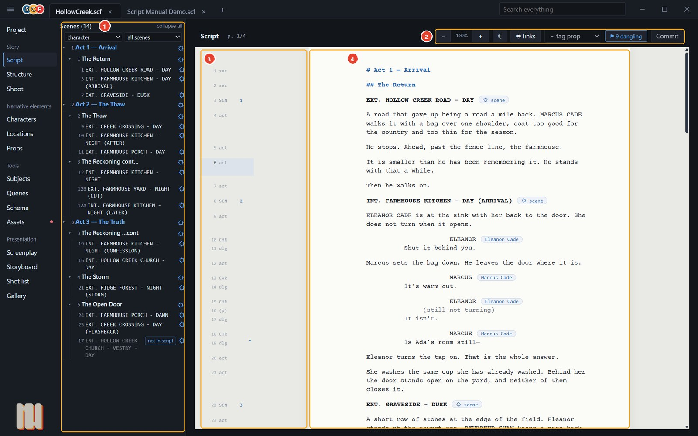

## The layout

The tab has four parts:

| | Part | What it does |
|---|---|---|
| ① | **Scene rail** (left) | Every scene, grouped under its act and sequence. Click one to jump to it. Filter it, reorder it, open records. |
| ② | **Toolbar** (top) | Page count, zoom, page colour, links on or off, prop tagging, integrity warnings and **Commit**. |
| ③ | **Gutter** (grey strip) | Line number, line type and scene number for every line. A dot marks a line with performance beats on it. |
| ④ | **Page** (white) | The screenplay itself, laid out in standard Courier format. |

Each part has its own section below.

## Starting a screenplay

A new project's Script tab offers two ways in.

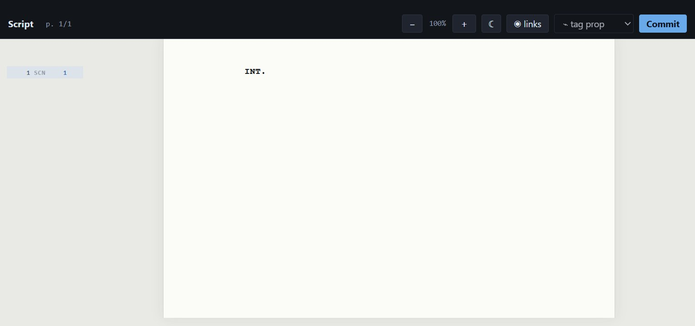

- **Import Fountain / FDX** reads a Fountain (`.fountain`, `.txt`) or
  Final Draft (`.fdx`) file and shows you everything it found before
  anything is written. The [quickstart](editor-quickstart.html#s2)
  walks through that review screen. Your original file is only read,
  never changed.
- **Start blank** gives you a single scene-heading line with `INT. `
  already typed, and the cursor ready.

## How lines work

Everything about formatting comes down to one rule: **every line has
exactly one type**, and the type decides how it looks.

| Type | Gutter | What it's for | How it's laid out |
|---|---|---|---|
| Scene heading | `SCN` | `INT. FARMHOUSE KITCHEN - DAY` | Bold capitals, left margin. Starts a new scene. |
| Action | `act` | What we see and hear | Full width |
| Character | `CHR` | The name above a speech | Capitals, indented far in |
| Dialogue | `dlg` | What they say | Narrow column, indented |
| Parenthetical | `(p)` | `(still not turning)` | Narrower, between cue and line |
| Transition | `TRN` | `CUT TO:` | Capitals, right-aligned |

Imported scripts can also contain **centered** text (`ctr`), **lyrics**
(`lyr`), **sections** (`sec`, the `#` act and sequence lines),
**synopses** (`syn`) and **notes** (`nte`). The editor shows and keeps
all of these, but the Tab key doesn't cycle through them (see
[Acts and sequences](#acts-and-sequences-in-the-script)).

Three more rules are worth knowing early:

- **There are no blank lines.** The space between a heading and its
  action, or between two speeches, is drawn by the editor. Pressing
  Enter always gives you a new line to type on, never an empty spacer.
  This is why the page always looks properly spaced, whatever you do.
- **The editor doesn't second-guess you.** Once a line has a type, it
  keeps it until *you* change it. The editor never looks at your words
  later and decides a line is "really" dialogue. The one exception is
  below: typing `INT.` or `EXT.` on an action line.
- **The type lives in the line, not in the text.** You don't type
  Fountain symbols like `@` or `>` to force a type. You set it with Tab,
  and the editor adds whatever an export needs.

## Formatting with Tab and Enter

### Tab cycles the line type

Put the cursor anywhere on a line and press **Tab**. The line changes to
the next type in this cycle:

**Action → Character → Dialogue → Parenthetical → Transition → Scene heading →** back to Action

**Shift+Tab** goes the other way. The text stays exactly as it is;
only the type, and so the layout, changes. The gutter label updates
straight away, so you can always see what you're on.

Here, the cursor is on a new line under some action. One Tab has turned
it into a character line: the gutter says `CHR`, and the cursor has
jumped in to where a name goes.

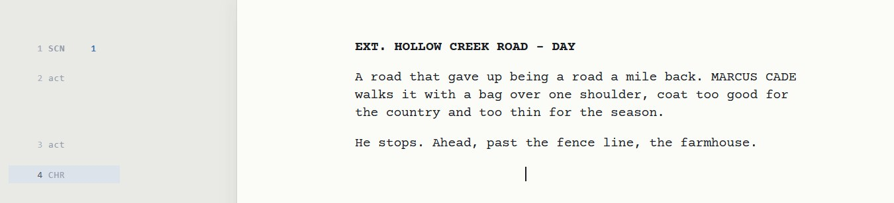

### Enter picks the next type for you

When you press **Enter** at the end of a line, the new line gets the
type that usually comes next:

| You pressed Enter on… | The new line is… |
|---|---|
| Scene heading | Action |
| Action | Action |
| Character | Dialogue |
| Parenthetical | Dialogue |
| Dialogue | Character |
| Transition | Scene heading |

So most of the time you just type and press Enter: heading, action,
action, Tab to a character, name, Enter, dialogue, Enter, the next
name… If the guess is wrong, press Tab.

### Enter twice for a new scene

Pressing **Enter on an empty line** turns that line into a scene
heading. So, at the end of a scene, **Enter, Enter** gets you straight
to the next heading. That works from any type of line.

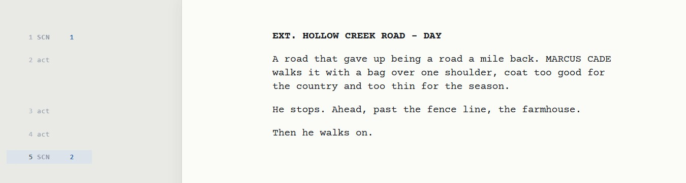

If you press Enter a third time, you get an ordinary new line, so you
can never get stuck on an empty heading.

### Shift+Enter keeps the same type

**Shift+Enter** starts a new line of the *same* type, without the usual
guess. Use it for a second paragraph of dialogue, or two action
paragraphs in a row.

### Typing INT. or EXT. makes a heading

On an action line, as soon as you type `INT.`, `EXT.`, `EST.` or `I/E`
followed by a space, full stop or slash, the line becomes a scene
heading by itself. That's the one time the editor changes a type for
you, and Tab can always change it back.

### Capitals are automatic

Scene headings and character names are typed in capitals for you. Type
`ext. hollow creek road` and it appears as `EXT. HOLLOW CREEK ROAD`.
The capitals are stored that way, not just displayed, so exports and
the scene rail all agree.

Spellcheck stays on for action and dialogue, and off for headings, cues,
transitions and sections, which are mostly names.

### Paste

Pasted text always arrives as **action** lines, one line per line of the
paste. The editor doesn't try to guess types from pasted text. Go
through the pasted lines and Tab each one to its proper type.

### An example

Here's a short scene from *Hollow Creek*, written from scratch using
nothing but typing, Enter and Tab:

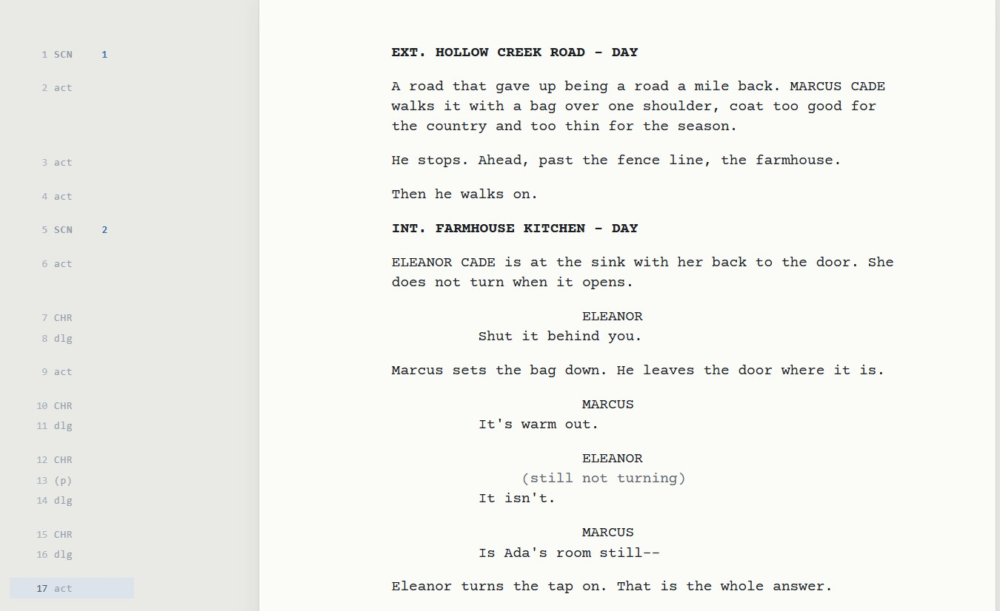

1. Type the heading. Enter gives you an action line.
2. Write the action. Enter gives another action line.
3. **Tab** once to make it a character line, type `eleanor`. It comes out
   as `ELEANOR`.
4. Enter gives you dialogue. Type the line.
5. Enter gives you a character line for the reply.
6. For a parenthetical, press **Tab** on the empty dialogue line under
   the cue, type `(still not turning)`, then Enter for the dialogue.
7. To end on a transition, type `CUT TO:` on a new line and Tab until
   the gutter says `TRN`.

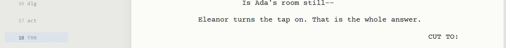

## Autocomplete

As you type, the editor suggests what's likely to come next. Use the
arrow keys to choose and **Enter** to accept, keep typing to ignore it,
or press **Esc** to close the list. (Tab still changes the line type,
even with the list open.)

**On a scene heading:**

- On an empty or very short heading, it offers `INT.`, `EXT.`,
  `INT./EXT.` and `EST.`.
- After the prefix, it offers **locations that already exist** in the
  project. Accepting one adds ` - ` so you can go straight on to the
  time of day.

  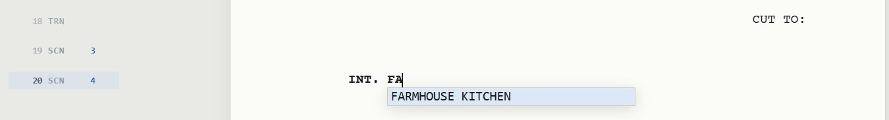

- After ` - `, it offers times of day: DAY, NIGHT, MORNING, AFTERNOON,
  EVENING, DAWN, DUSK, SUNSET, SUNRISE, TWILIGHT, MIDDAY, CONTINUOUS,
  LATER, MOMENTS LATER and SAME TIME.

  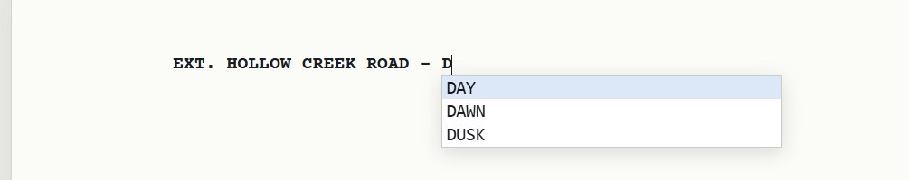

**On a character line:** after two letters, it offers **characters that
already exist**. Extensions in brackets, such as `(V.O.)`, are ignored
while matching.

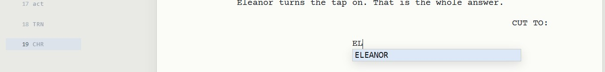

Suggestions come from what's already in the project, so a brand-new
location or character isn't offered until you've committed it once
(see below).

## The gutter

The grey strip to the left of the page shows three things for every
line:

- **Line number.** Its position in the script.
- **Type.** `SCN`, `act`, `CHR`, `dlg`, `(p)`, `TRN` and so on. It's
  the fastest way to check what a line is.
- **Scene number.** On heading lines only, counted down the script.

The line the cursor is on is highlighted. A small **blue dot** to the
right means one or more **performance beats** are attached to that line
(beats are set up elsewhere, for example from a character's
workspace).

## Saving and Commit

There are two kinds of saving here, and it's worth knowing which is
which.

**Your text saves itself.** About a second after you stop typing, and
whenever you click away from the page, the script is written to the
`.scf` file. There's no Save button for the words, and nothing to lose
if you close the app.

**Commit creates things.** New headings need scenes and locations, and
new names need characters. The editor doesn't create those behind your
back while you're mid-sentence. When there's something to create, the
**Commit** button lights up. Click it, or press **Ctrl+S** (**Cmd+S** on
a Mac), and you get a review first:

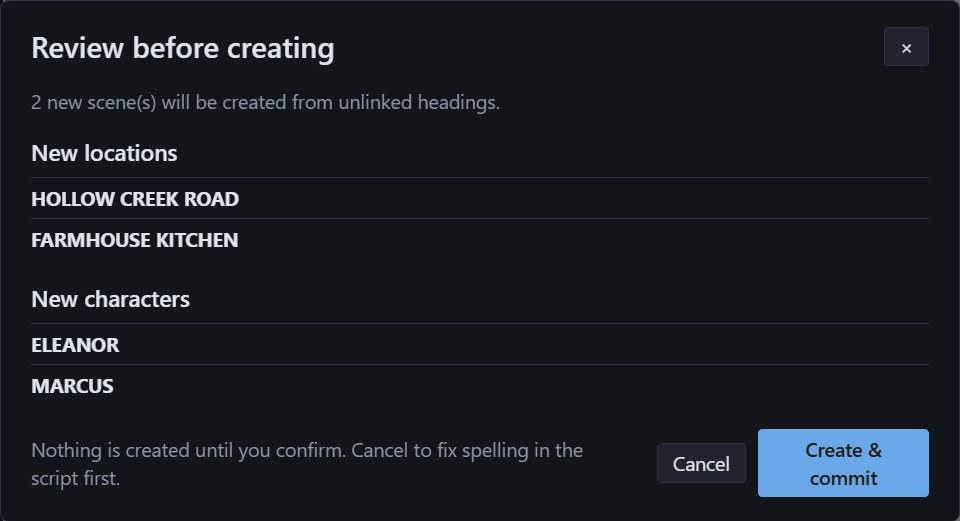

The review lists:

- **New scenes** to be made from headings that aren't linked to one yet.
- **New locations**, with any similar existing ones flagged, so
  `FARMHOUSE KITCHEN` and `FARM HOUSE KITCHEN` don't both get made by
  accident.
- **New characters**, likewise with near matches flagged.
- **New structure**: acts and sequences from section lines (see below).
- **Cue mismatches**, where a cue now says one name but is still linked
  to another character. For each, choose to leave the link as it is,
  break it and create or match the new name, or rename the character
  so all its cues update.

Nothing is created until you click **Create & commit**. If you spot a
typo, click **Cancel**, fix it in the script and commit again.

After a commit, the toolbar briefly confirms what was made ("created 2
scene(s), 2 location(s), 2 character(s)"), and the new links appear on
the page as **chips**.

## Chips: the links on the page

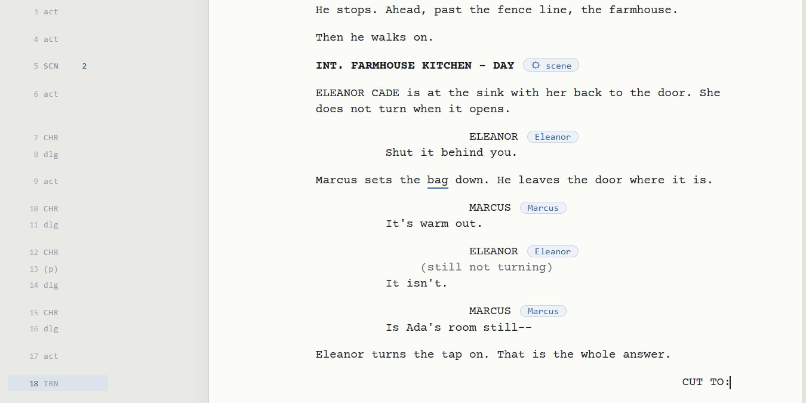

- A **⛭ scene** chip after a heading means it's linked to a scene
  record. Click it to open that scene.
- A **name chip** after a character cue (here, *Eleanor* and *Marcus*)
  shows which character the cue belongs to. Click it to open that
  character's workspace. The chip shows the character's full name, so
  `ELEANOR` linked to *Eleanor Cade* is easy to confirm at a glance.
- An **underline** marks words tagged as a prop (see
  [Tagging props](#tagging-props)). Hover over it to see which prop.

The **links** button in the toolbar hides chips, underlines and beat
dots when you just want to read.

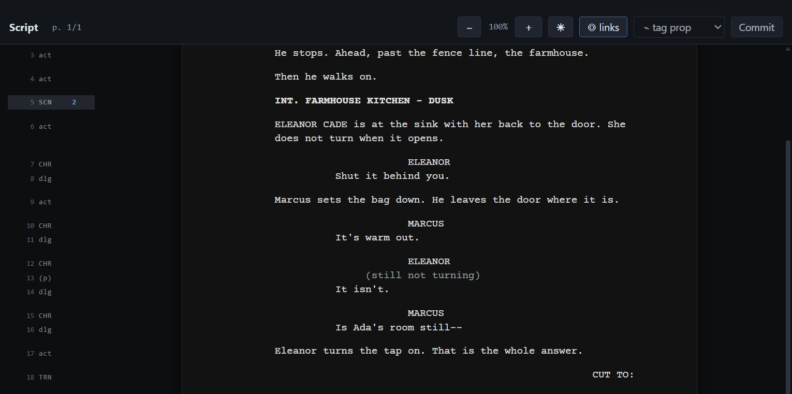

## When a heading changes

If you edit a heading that's already linked to a scene, the editor
doesn't silently rename the scene. Maybe it's the same scene with a
better name, or maybe you're turning it into a different scene. Instead,
it asks:

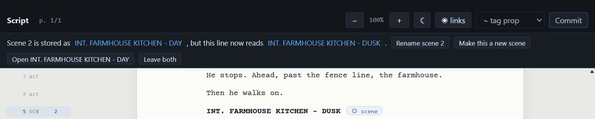

- **Rename scene N** updates the scene record to match the new heading:
  its name, interior or exterior, time of day and location. Use it when
  it's the same scene, renamed. If the new location doesn't exist yet,
  the next Commit will offer to create it.
- **Make this a new scene** breaks the link. The old scene record stays
  as it is, and the next Commit offers to make a fresh scene from this
  line.
- **Open…** shows you the scene record before you decide.
- **Leave both** hides the notice and changes nothing.

If you clear a heading's text completely, the notice offers **Take the
scene out of the script** instead.

> **Note.** This notice appears when you Commit or click away straight
> after editing a heading. If you keep typing and the text autosaves
> first, the notice may not appear, and the scene keeps its old name in
> the rail. If the rail and the heading disagree, open the scene from its
> chip and check.

## Tagging props

You can link any words in the script to a prop, so the prop knows where
it appears.

1. Select some text **within one line**, such as *bag*.
2. **Right-click** the selection, or open the **⌁ tag prop** menu in
   the toolbar.
3. Pick an existing prop, or choose **New prop…** and give it a name.

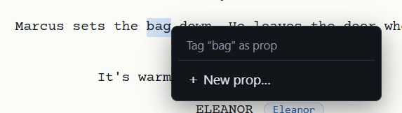

The tagged words get an underline. The tag belongs to that line, so it
survives edits to the rest of the script, and the prop is linked to the
scene automatically. If you later delete the words or the line, the tag
is kept but flagged as **dangling** (see below), so nothing quietly
disappears.

## Acts and sequences in the script

In Fountain, a line starting with `#` is a **section**. The editor reads
section lines as structure:

- A section that contains the word **ACT** is an act. One that contains
  **SEQUENCE** (or **SEQ**) is a sequence.
- Otherwise the number of `#`s decides: `#` is an act, `##` a sequence.
- Each act or sequence starts at **the next scene heading below it**.

Section lines appear in blue with `sec` in the gutter, and Commit lists
any new ones under **New structure**.

In this version, the Tab cycle doesn't include sections, so a `#` line
typed by hand stays an action line. Sections come in with an imported
Fountain file. To add or move acts and sequences in a script you're
writing here, use the [Structure tab](editor-quickstart.html#s3),
which shows the result in the scene rail here too.

## The scene rail

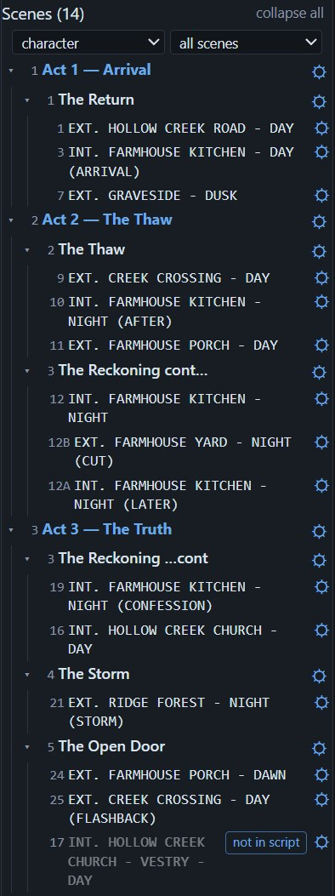

The rail lists every scene in script order, under its act and sequence.

- **Click a scene** to scroll the page to its heading.
- **⛭** opens the scene, act or sequence record.
- The **number** on the left is the scene number. Scenes numbered like
  `12A` and `12B` follow the project's numbering policy.
- **▾** collapses an act or sequence. **collapse all / expand all**
  works on the whole tree.
- A scene marked **not in script** has a record but no heading in the
  screenplay any more. Nothing linked to it has been touched. It just
  has no number and no act until its heading is back. If you meant to
  cut it, mark it cut yourself.
- A heading that isn't linked to a scene yet shows with a **·** instead
  of a number until you commit.
- If there are no acts yet, the rail says **No structure yet** and lists
  scenes on their own.

### Reordering scenes

**Drag a scene** in the rail and drop it before another, or on **drop
here to move to the end**. The heading and every line of the scene move
together in the script, and everything attached to them goes too.
Dragging is turned off while a filter is on.

### Duplicating and removing scenes

**Right-click** a scene in the rail:

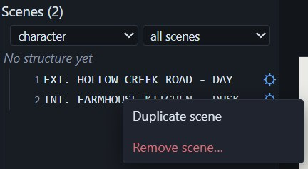

- **Duplicate scene** copies the scene and its lines straight after the
  original, as a new scene record. Prop tags and beats stay with the
  original.
- **Remove scene…** deletes the scene record, its script lines and
  everything that belongs only to it, such as its shots and cast links.
  A confirmation lists exactly what will go. **This cannot be undone.**
  Props and characters themselves are never deleted, only their links
  to this scene.

  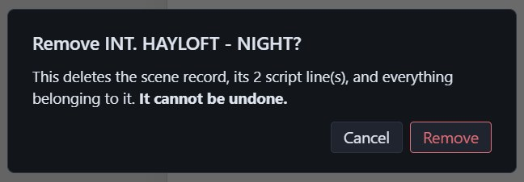

### Filtering

The two menus at the top of the rail narrow it to the scenes that
contain a particular **character**, **prop** or **location**. Pick the
kind on the left and the item on the right. Acts and sequences stay
visible only where they still have a matching scene, and the count
underneath says how many scenes match.

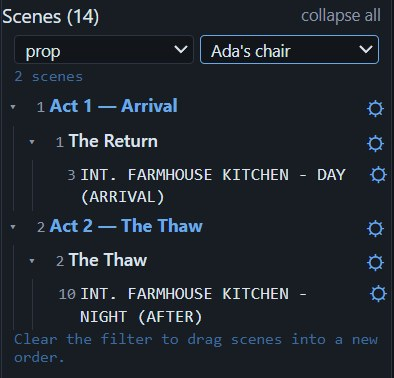

Choose **all scenes** to clear the filter.

## The toolbar

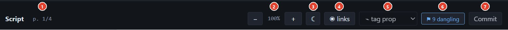

| | Control | What it does |
|---|---|---|
| ① | **p. 1/4** | The page the cursor is on, out of the total, estimated from standard screenplay page lengths. The Screenplay tab has the exact pagination. |
| ② | **− 100% +** | Zoom the page. The editor remembers your zoom. |
| ③ | **☾ / ☀** | Switch the page between white and dark. Only the page changes, not the export. |
| ④ | **◉ links / ◎ links** | Show or hide chips, prop underlines and beat dots. |
| ⑤ | **⌁ tag prop** | Tag the selected text as a prop. Greyed out until you select text. |
| ⑥ | **⚑ N dangling** | Only shown when something has lost its line. Opens the integrity panel. |
| ⑦ | **Commit** | Lit when there are scenes, locations, characters or structure to create, or mismatches to sort out. Opens the review. Shortcut **Ctrl+S**. |

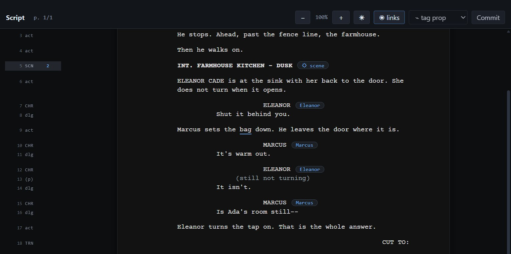

## Script integrity

Editing a script means deleting lines, and some of those lines had
things attached. The editor never throws those things away on its own.
When something has lost its line, the toolbar shows **⚑ N dangling**.
Click it to see the list:

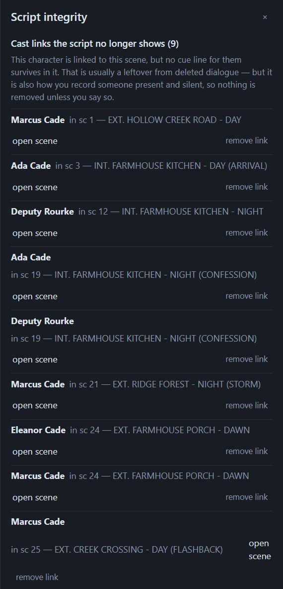

It groups the problems:

- **Prop tags with no line.** The tagged words are gone. Remove the tag;
  the prop itself stays.
- **Beats with no line.** A performance beat pointed at a deleted line.
  Keep the beat without its anchor, or open it.
- **Other line anchors with no line.** A shot, clip or other range
  pointed at a deleted line. Keeping it drops only the dead anchor.
- **Cast links the script no longer shows.** A character is linked to a
  scene where they no longer have a line. That's often left over from
  cut dialogue, but it's also how you record someone who's present and
  silent, so you decide: **open scene** to check, or **remove link**.

Nothing in the panel happens unless you click it.

## Keyboard reference

| Keys | What it does |
|---|---|
| **Tab** | Next line type: Action → Character → Dialogue → Parenthetical → Transition → Scene heading |
| **Shift+Tab** | Previous line type |
| **Enter** | New line, with the usual next type |
| **Enter** on an empty line | Make it a scene heading |
| **Shift+Enter** | New line of the same type |
| **Ctrl+S** / **Cmd+S** | Commit (review first) |
| **Ctrl+Z** / **Ctrl+Y** | Undo / redo. Type changes are undone along with text. |
| **↑ ↓** then **Enter** in a suggestion list | Accept the suggestion |
| **Esc** | Close the suggestion list |
| **Alt+1** | Jump to the Script tab from anywhere |

## Tips

- **Joining two lines keeps the first line's type.** Delete the break
  between an action line and a heading below it, and the joined line is
  action. Press Shift+Tab or Tab to put it right.
- **Commit when a scene is done, not after every line.** Text is already
  safe. Commit is for creating scenes, locations and characters, and the
  review is easier to read with a few at once.
- **Fix names before committing.** If the review shows a near-duplicate
  character or location, cancel, fix the spelling in the script, and
  commit again. It's quicker than merging records afterwards.
- **Use the rail to move scenes, not cut and paste.** Dragging in the
  rail moves a scene with everything attached to it. Cutting and pasting
  text creates new lines that have lost those links.
