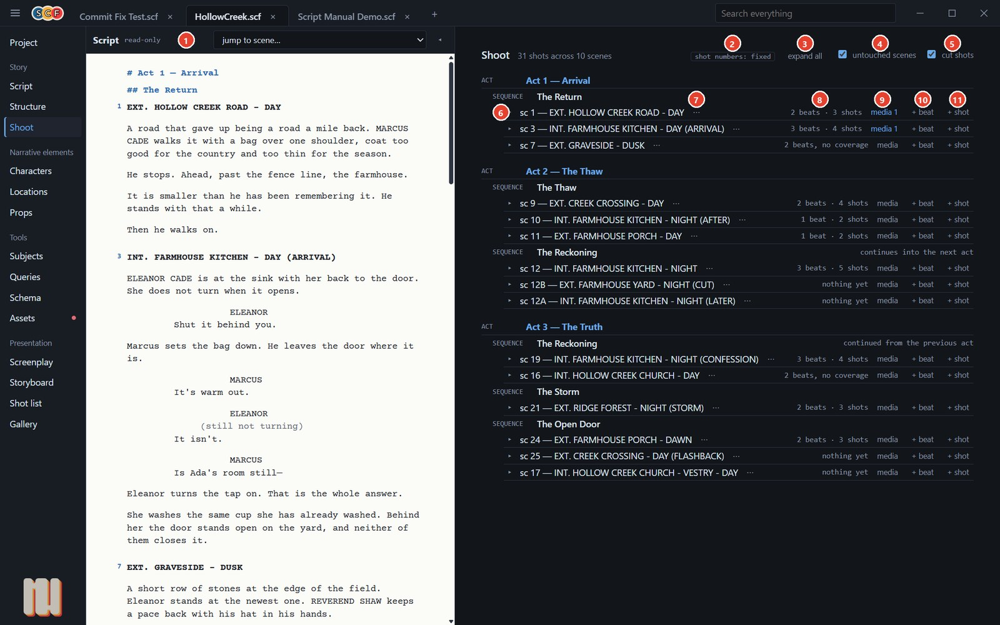
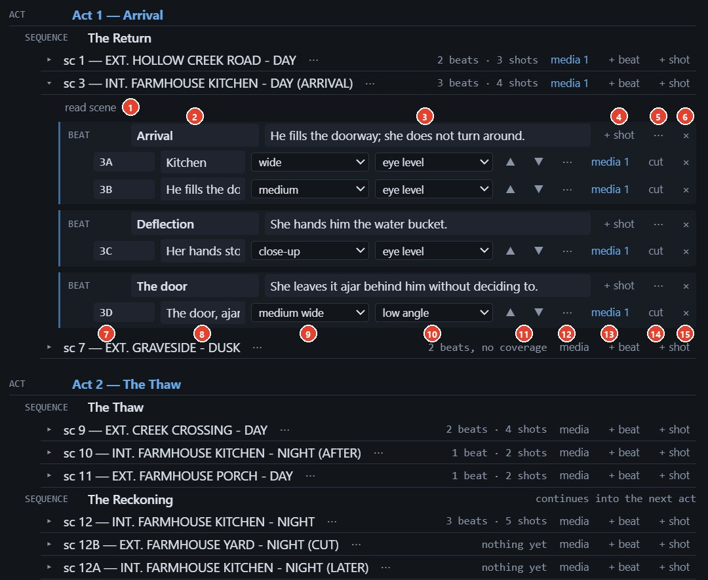
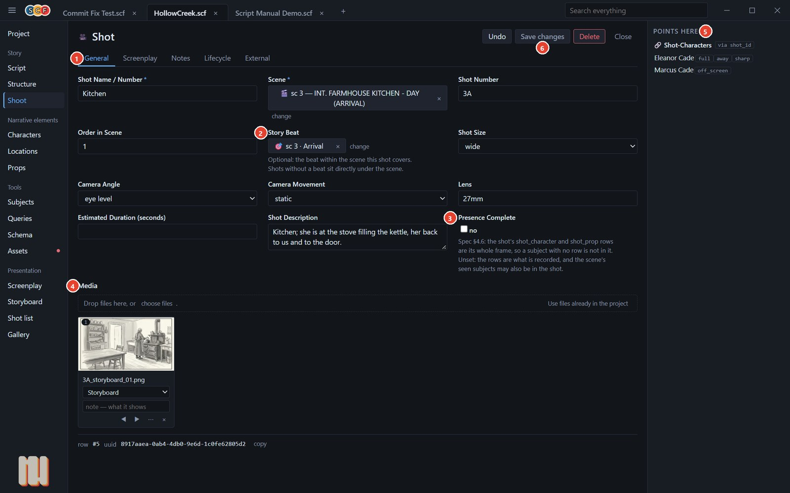
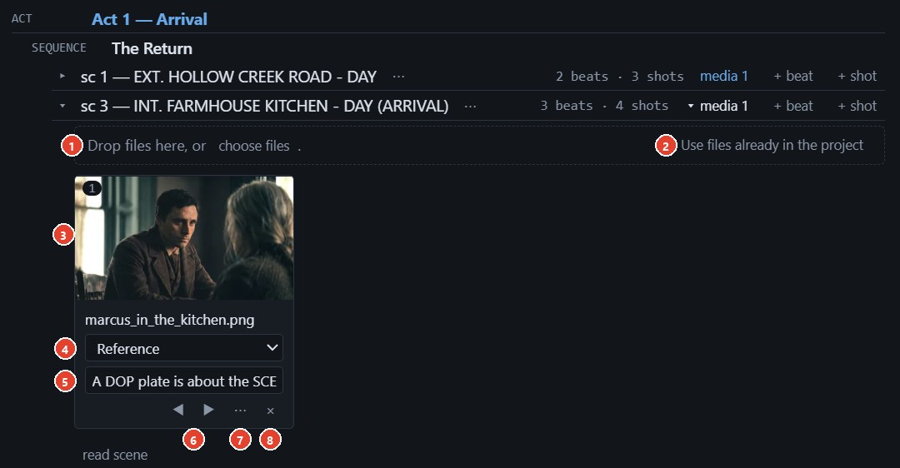

<!-- SPDX-License-Identifier: CC-BY-4.0 -->
# The Shoot tab

The Shoot tab is where you plan coverage: the beats inside each scene,
and the shots that cover them. It's also where storyboards, frames and
reference images get attached to shots and scenes.

## The layout

As on the Structure tab, a **read-only copy of the script** ① sits on
the left. Click a scene's name on the right and the copy scrolls to it.
**◂** hides it.

The right-hand side is the plan. The header gives the totals (*31 shots
across 10 scenes*) and a few controls:

| | Control | What it does |
|---|---|---|
| ② | **shot numbers: fixed / derived** | Shows the project's numbering policy. Hover for what it means here. |
| ③ | **expand all / collapse all** | Opens or closes every scene |
| ④ | **untouched scenes** | Untick to hide scenes with no beats or shots yet |
| ⑤ | **cut shots** | Untick to hide shots that have been cut |

Below that the whole film is listed in story order, under its acts and
sequences. Those come from the script and the Structure tab, and can't
be changed here.

## Scenes, beats and shots

Coverage has three levels:

- **Scene**: from the script.
- **Beat** (optional): a moment inside the scene. "He fills the doorway;
  she does not turn around."
- **Shot**: one camera setup. It can sit inside a beat, or straight on
  the scene if you don't use beats.

Each scene row shows:

- ⑥ **▸** to open it, then the scene number and heading (click it to
  show the scene in the script)
- ⑦ **⋯** to open the full scene record
- ⑧ a summary: *3 beats · 4 shots*, *2 beats, no coverage*, or *nothing
  yet*
- ⑨ **media**: the scene's own pictures (see [Media](#media))
- ⑩ **+ beat** and ⑪ **+ shot**

Open a scene to see its beats and shots:

**read scene** ① shows the scene's script text right there, so you can
plan without looking across. The numbers above the first beat mark the
parts of a beat row. The numbers under the last shot mark the columns of
every shot row.

### Beats

**+ beat** adds a beat at the end of the scene, named *Beat A*, *Beat B*
and so on. Each beat row has:

- ② **Name** and ③ **what happens**, typed straight into the row
- ④ **+ shot** to add a shot to this beat
- ⑤ **⋯** for the full beat record
- ⑥ **×** to delete the beat. Its shots aren't deleted; they move onto the
  scene.

Shots on a scene that has beats, but which aren't in any beat, are
listed under **on the scene, no beat**.

### Shots

**+ shot** (on a scene or a beat) adds a shot with the next free code
for that scene: 3A, 3B, 3C… Each shot row is a compact editor:

| | Part | What it is |
|---|---|---|
| ⑦ | **Code** | The shot number. Click to change it. |
| ⑧ | **Description** | What we see: "Kitchen", "The door, ajar" |
| ⑨ | **Shot size** | extreme wide, wide, medium wide, medium, medium close-up, close-up, extreme close-up |
| ⑩ | **Camera angle** | eye level, high angle, low angle, overhead, dutch, POV |
| ⑪ | **▲ ▼** | Move the shot up or down within the scene |
| ⑫ | **⋯** | The full shot record |
| ⑬ | **media** | The shot's storyboards and frames |
| ⑭ | **cut** / **restore** | Take the shot out of the film, or put it back |
| ⑮ | **×** | Delete the shot permanently (asks first) |

Text saves when you click away, and the dropdowns save at once.

### Cut, don't delete

**cut** marks a shot as not in the film, but keeps it: its code, media
and notes all stay, and **restore** brings it back. Cut shots stay in
the list in grey, or untick **cut shots** to hide them.

**×** really deletes. The editor asks first, and suggests cutting
instead. Unlike most deletes, removing a shot from this row can't be
undone from the toast.

### Shot numbers

New shots get the scene's number plus a letter. What happens later
depends on the [numbering policy](editor-project.html#numbering-policy):

- **Fixed:** codes never change. A shot moved to a new position keeps
  its code.
- **Derived:** a shot code is still an identifier you've given to a
  crew, so it's never rewritten to match its position. A shot whose code
  no longer matches its place shows the code it *would* have (for
  example **≠ 3C**), so you can see what to reissue. When a scene is
  renumbered, its shots' codes follow the new scene number.

## The full shot record

**⋯** on a shot opens everything about it:

The tabs ① split the fields up. **General** has the fields from the
row, plus:

- **Camera Movement**: static, pan, tilt, dolly, tracking, crane,
  handheld, steadicam, drone or zoom.
- **Lens**: free text, such as 27mm.
- **Estimated Duration (seconds)**.
- ② **Story Beat**: which beat it covers. Clear it to put the shot
  straight on the scene.
- ③ **Presence Complete**: tick it when the shot's character and prop list
  is the *whole* frame. Anyone not listed is then known to be out of
  shot. Leave it unticked and the scene's cast may also be in it.

The other tabs:

- **Screenplay**: which lines of the script this shot covers (below).
- **Notes**.
- **Lifecycle**: active, draft, superseded, deprecated, cut or archived.
- **External**: an id from another tool, such as a shot tracker.

Its storyboards and frames are under **Media** ④. Who and what is in
frame is listed on the right under **Points here** ⑤.
In this record, Eleanor Cade is *full, away, sharp* and Marcus Cade is
*off_screen*. Each of those is its own small record, with framing,
facing and focus.

Unlike the rows on the Shoot tab, this form keeps a draft. Press **Save
changes** ⑥ when you're done, or **Close** to throw the draft away.

### Lines covered

On the **Screenplay** tab of a shot record, **Lines covered** ties the
shot to the script. Either:

- pick a **First line** and **Last line** from the menus, or
- click a line in the scene text, then click the last one (or the same
  line again for just one).

The scene must be committed first, since only committed lines can be
picked. **Clear** removes the range.

Once a shot is tied to lines, it follows them. Rewrite the words around
them in the Script tab and the shot still knows what it covers.

## Media

Every scene and every shot has a **media** button. It opens a strip of
the pictures and clips attached to it:

To add files:

- ① **Drop files** onto the strip, or click **choose files**. They must be
  inside the [project folder](editor-project.html#project-folder).
- ② Or **Use files already in the project** to pick from what's already
  imported.

The editor then asks what the files are for:

| Purpose | Meaning |
|---|---|
| **Storyboard** | A panel planning the shot. Panels keep the order you give them. |
| **Start frame** | The frame it opens on. For a generator, the first frame. |
| **End frame** | The frame it closes on. For a generator, the last frame. |
| **Previs** | A moving rough: an animatic, blocking render or previs clip. |
| **Reference** | Anything else: a clip, a sound, a scan, a lighting plate. |

Each tile then has:

- ③ the picture. Click it to open the file.
- ④ a **purpose** menu, to change it later
- ⑤ a **note** ("what it shows")
- ⑥ **◀ ▶** to reorder
- ⑦ **⋯** to show the file in Assets
- ⑧ **×** to take it off this shot or scene. The file stays in the project.

Media changes can be undone from the toast.

The picture that stands for a shot on the Storyboard and Shot list tabs
is its first **Storyboard** panel, or else its **Start frame**.

## Tips

- **Beats are optional.** For a simple scene, put shots straight on it.
  Add beats when a scene has distinct moments worth naming.
- **Plan from the script.** **read scene** is right there, and **Lines
  covered** keeps each shot tied to what it shoots.
- **Cut rather than delete** while you're still deciding. A cut shot is
  out of the film and the storyboard, but nothing is lost.
- **Check the Shot list tab** when you're done. It prints this plan as
  a paper shot list with the storyboard frames.
