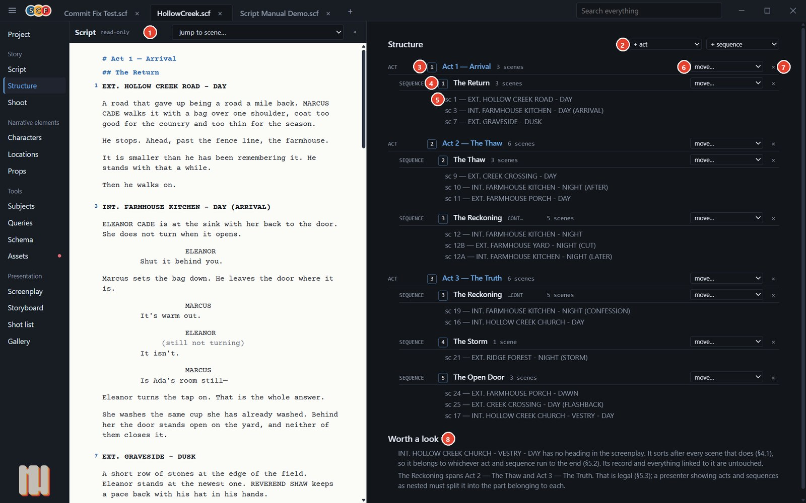

<!-- SPDX-License-Identifier: CC-BY-4.0 -->
# The Structure tab

The Structure tab lays the script out as acts and sequences, and lets you
say where each one begins. It's a small tab with one idea behind it, and
once that idea clicks the rest follows.

## The one idea: a span starts at a scene

An act or sequence stores exactly one fact: **the scene it starts at**.
It then runs until the next act (or sequence) begins. The last one runs
to the end of the script.

That has some useful consequences:

- **Two placements make a three-act film.** Act 1 starts at the first
  scene, Act 2 at the scene you choose, Act 3 at another, and every scene
  in between is accounted for.
- **New scenes join automatically.** Write a scene in the middle of Act
  2 and it's in Act 2. Nothing needs updating.
- **Moving a boundary is one change.** Move where Act 2 starts and Act 1
  gets longer (or shorter) at the same time.

### Acts and sequences are separate

Acts and sequences are **two independent sets of spans**, not a tree. A
sequence usually sits inside one act, but it doesn't have to. When one
crosses an act boundary, it appears in both acts, marked:

- **cont…** where it carries on into the next act
- **…cont** where it picks up from the previous one

In Hollow Creek, *The Reckoning* starts in Act 2 and ends in Act 3, so it
shows twice. That's allowed. The **Worth a look** notes at the bottom
mention it only so you know.

### Story order

Scenes are listed in **story order**: the order of their headings in the
committed script. Scene numbers are labels, not positions. With numbering
policy set to fixed, as Hollow Creek is, you'll see orders like sc 12,
sc 12B, sc 12A. That's correct: 12B was moved up, and kept its number.

Scenes that have no heading in the script (records made by hand, or
whose heading was deleted) sort after all the others.

## The layout



| | Part | What it is |
|---|---|---|
| ① | **Script copy** | A read-only copy of the last committed script. **jump to scene…** scrolls it; **◂** hides it and **Script ▸** brings it back. Drag its edge to resize it. |
| ② | **+ act / + sequence** | Start a new act or sequence at the scene you pick |
| ③ | **An act** | Its number, name and scene count. Click the name to open its record. |
| ④ | **A sequence** | The same, one level in |
| ⑤ | **A scene** | Click to show it in the script copy. Nothing changes. |
| ⑥ | **move…** | Choose a new start scene |
| ⑦ | **×** | Take the span out of the outline (see below) |
| ⑧ | **Worth a look** | Notes about anything unusual |

Lines typed in the Script tab since the last Commit aren't in the copy
yet. If any act or sequence has no start scene, a **Not placed** section
appears above Worth a look.

## Making and moving acts and sequences

All of these write to the file straight away.

| To… | Do this |
|---|---|
| **Add an act** | Pick its first scene from **+ act**. A new act called *Untitled act* starts there. |
| **Add a sequence** | Pick its first scene from **+ sequence**. |
| **Rename** | Click the name to open its record, change **Name**, and **Save changes**. |
| **Move where it starts** | Pick a new start scene from its **move…** menu. The span before it grows or shrinks to match. |
| **Take it out of the outline** | Click **×**. The span before it takes over its scenes. |
| **Put it back** | Under **Not placed**, choose a scene from **starts at…**. |
| **Delete it entirely** | Open its record and use **Delete**. |

**×** doesn't delete anything. It only clears the start scene, so the act
or sequence moves to **Not placed** with its name and notes intact. That
makes it safe to try a different shape and change your mind.

If two acts start on the same scene, one of them ends up empty. The
outline says **empty — another span starts on the same scene**, and
Worth a look flags it.

### Numbering

When the project's numbering policy is **derived**, acts and sequences
are renumbered 1, 2, 3… in story order every time you add, move or remove
one. When it's **fixed**, their numbers stay as they are. The policy
lives on the [Project tab](editor-project.html#numbering-policy). The
Structure tab never renumbers scenes or shots.

## Writing structure in the script

You can also make acts and sequences from the Script tab, by writing
section lines above a scene heading:

```
# Act 2 — The Thaw
## The Reckoning
INT. FARMHOUSE KITCHEN - NIGHT
```

On **Commit**, each section line becomes an act or sequence starting at
the next heading below it:

- A line with "act" in it is an act. A line with "sequence" or "seq" is
  a sequence.
- Otherwise, a single `#` is an act and `##` is a sequence.
- Editing the text of a line that's already linked renames the record.

The Script tab's scene rail shows the same act and sequence tree as this
tab. Dragging a scene there to a new position can carry it into a
different act. See the [Script manual](editor-script.html) for both.

## Worth a look

These notes never block anything. They point out things you might not
have meant:

- An act or sequence with no start scene, so it appears nowhere.
- One that starts at a scene that no longer exists.
- Two that start at the same scene, so one is empty.
- A sequence that crosses an act boundary (allowed, just noted).
- A span starting at an unnumbered scene.
- A scene with no heading in the script.
- Scenes that come before the first act.

## Tips

- **Commit the script first.** The outline follows committed headings,
  so a scene you've just written appears here only after a Commit.
- **Place acts, then sequences.** Get the big shape right with two or
  three acts, then add sequences inside them.
- **Use × to experiment.** Taking a span out loses nothing, and **starts
  at…** puts it back.
- Changes on this tab don't go on the undo toast, but **×** and
  **move…** are easy to reverse by hand.
