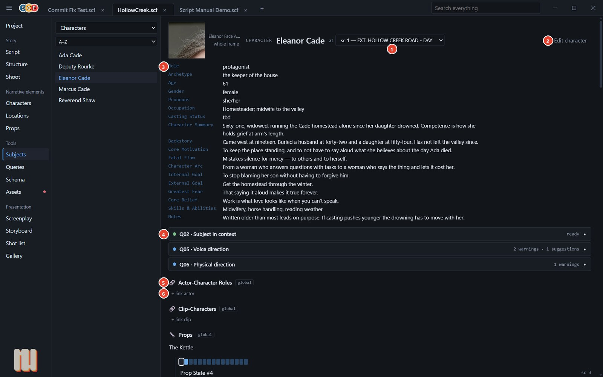
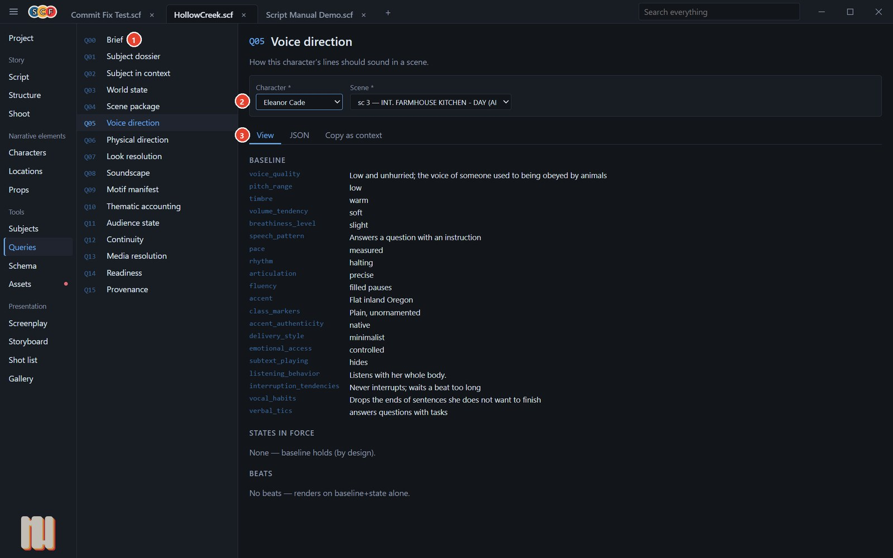
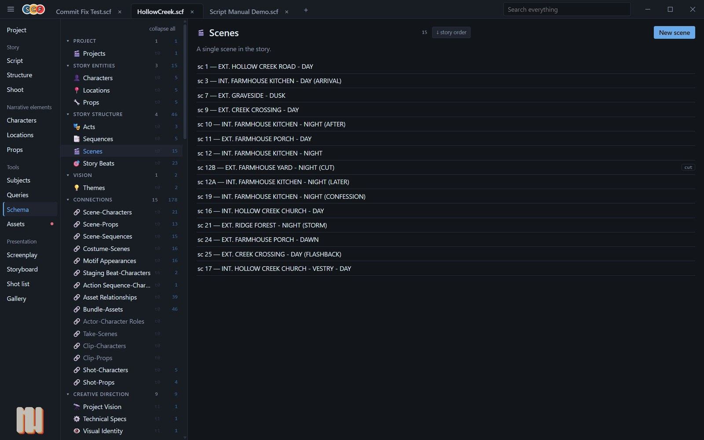
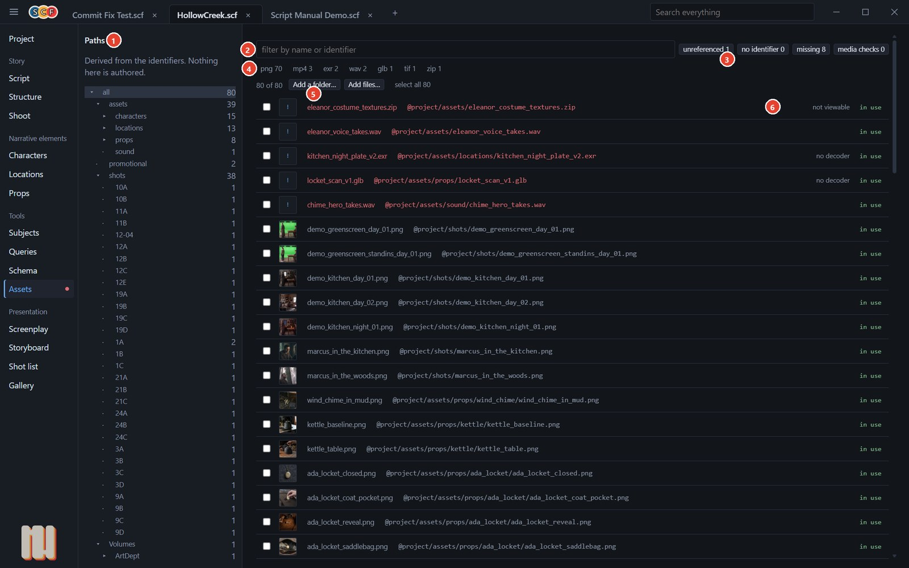
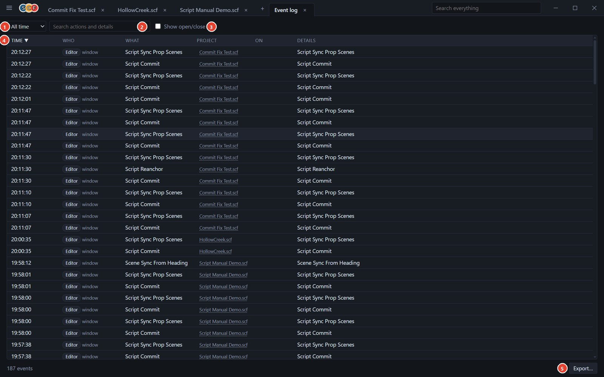

<!-- SPDX-License-Identifier: CC-BY-4.0 -->
# The Tools tabs

The four Tools tabs look underneath the friendly workspaces. They're
there when you want to see everything attached to one thing, ask the
file a question the way an assistant would, edit any record directly,
or manage media files.

| Tab | Use it to… |
|---|---|
| **Subjects** | See everything that points at one character, location, prop, scene or shot |
| **Queries** | Run the standard SCF questions and see exactly what a tool would get back |
| **Schema** | Browse and edit every record of every type |
| **Assets** | Import, find, check and organise the media files |

The **Event log** lives in the app menu and is covered at the end.

## Subjects

Pick a kind of thing at the top of the rail (Characters, Locations,
Props, Scenes, Shots, Stories, Themes or Projects), then pick one from
the list.

The page then shows:

- **The header**: a thumbnail, the name, and **Edit character** ② (or
  scene, prop…) to open the full record.
- ③ **Facts**: every field that has a value, read-only.
- ④ **Readiness**: how ready this subject is for the tools that will use
  it. For characters, pick a scene in **at** ①. For scenes, pick a shot or
  *scene-level*. Each check (*Q02 Subject in context*, *Q05 Voice
  direction*…) says **ready** or counts its blockers, warnings and
  suggestions. Open it for the details.
- ⑤ **Everything that points here**, grouped by type: props they own,
  costumes, scene links, shots, relationships… Each group has a strip
  showing where in the story each item is in force. Click an item to
  open it.

For link records you can also make and remove links right here:
⑥ **+ link actor**, **+ link clip** and so on, or **×** to remove one.

Subjects is the quickest way to answer "what does the file actually say
about Eleanor?"

## Queries

SCF defines sixteen standard questions, **Q00** to **Q15**. These are
the same ones an assistant asks over MCP. The Queries tab runs them for
you.

Pick a query from the rail ① and fill in what it asks for ②. It runs as
soon as every required box (marked *) is filled. Each answer comes three
ways ③:

- **View**: laid out to read.
- **JSON**: the exact result a tool receives.
- **Copy as context**: a ready-made block of text to paste into a
  prompt, with **Copy to clipboard**.

| Query | Asks for | Answers |
|---|---|---|
| Q00 Brief | — | The project in one block |
| Q01 Subject dossier | A character, location or prop | Everything about it |
| Q02 Subject in context | Subject, scene (and shot) | It as it is at that moment |
| Q03 World state | A scene | What's true of the world there |
| Q04 Scene package | A scene | Everything needed to stage it |
| Q05 Voice direction | Character, scene | How their lines should sound |
| Q06 Physical direction | Character, scene | How they should move |
| Q07 Look resolution | Scene (and shot) | Which images apply |
| Q08 Soundscape | A scene | What it should sound like |
| Q09 Motif manifest | A scene | The motifs in play |
| Q10 Thematic accounting | A theme | Where it's carried |
| Q11 Audience state | A scene | What the audience knows by then |
| Q12 Continuity | Two scenes | What changes between them |
| Q13 Media resolution | Subject, intent… | Which files to use |
| Q14 Readiness | A target query… | What's missing for it |
| Q15 Provenance | Any record | Where it came from |

Queries never change the file. The [Queries reference](queries.html)
describes each one in full.

## Schema

Schema lists every type of record in the file, grouped into categories:
Project, Story entities, Story structure, Connections, Creative
direction and more. Each type shows how many records it has.

Click a type to list its records. From the list you can:

- sort by **story order** or **A–Z** (for types that sit in the script)
- create one with **New scene** (or whatever the type is)
- click a record to open its full form

The **record form** is the same one **Open record** and **⋯** open
elsewhere:

- Its fields are grouped into tabs, with help text under each one.
- It keeps a **draft**: nothing is written until you press **Save
  changes** (or **Create** for a new record). **Undo** throws the draft
  away, and a dot means there are unsaved changes.
- **Delete** asks first. Records that pointed at the deleted one keep
  their reference, and the undo toast can bring it back.
- Asset records also show a preview and where the file resolves. Shot
  and scene records show their media.

Schema is where to go for anything the workspaces don't show, such as
themes, motifs, story beats or link records. Use it with care: it lets
you change anything, including fields the workspaces fill in for you.

## Assets

Every media file the project points at: images, video, audio, 3D, PDFs.
The `.scf` file stores an **address** for each one (such as
`@project/assets/props/kettle.png`), never the file itself. The address
is resolved against the [project folder](editor-project.html#project-folder).

### Finding files

- ① **Paths** on the left is a folder tree built from the addresses.
  Click a folder to show only what's in it.
- ② **filter by name or identifier** searches the list.
- ④ The format buttons (**png 70**, **mp4 3**…) filter by file type.
- ③ The toggles pick out problems:
  - **unreferenced**: files nothing uses
  - **no identifier**: records with no address
  - **missing**: addresses that point at no file. The list shows these
    in red ⑥, and they're what lights the red dot on **Assets**.
  - **media checks**: see below

Click a file to open its record, with a preview, file facts, and what
uses it.

### Importing

⑤ **Add a folder…** or **Add files…** brings files into the project. The
files must already be inside the project folder; nothing is copied. You
see a plan first (*12 new · 3 already here · 1 outside the project
folder*), then **Import**.

Dropping files on a reference board or media strip imports them the same
way.

### Moving files

If you move a folder on disk, select it in **Paths** and use **re-root**:
type the new prefix, **Preview** the changes, then **Apply**. Only the
addresses change. The files themselves aren't touched.

### Bundles

A **bundle** is a named set of files with a purpose. "Eleanor's face
set" is a bundle for visual identity. Tick files in the list and use
**add to bundle…** to make or extend one. In a bundle's record:

- **Resolves for** says who it applies to, and from which scene to which.
- **Bind to…** attaches it to a character, location or prop.

Reference boards in the workspaces build and bind bundles for you, so
you'll rarely need this by hand.

### Media checks

**media checks** lists things worth tidying: bundles bound to nothing,
duplicate bindings, files of the wrong kind for their bundle, and one
value spelled several ways. Two of its buttons (**use "…"** and **make
it a list**) fix the data straight away, with no confirmation.

## Event log

**☰ › Event log** opens a log of every change made to any project on this
computer, by you or by an assistant over MCP.

- ① **When** limits it to the last hour, today, the last 7 days or all
  time. ② The search box filters by action and detail.
- ③ **Show open/close** includes opening and closing files. An assistant
  does that around every request, so it's off by default.
- ④ Click a column heading to sort. Click a name in **Who** or **Project**
  to filter by it.
- Click a row to see exactly which fields changed, before and after.
- ⑤ **Export…** saves the filtered events as a `.jsonl` file.

It's the place to check what an assistant actually did to your file.
