<!-- SPDX-License-Identifier: CC-BY-4.0 -->
# Editor quickstart

The SCF Editor is a desktop app for building up everything that is true
about a film: the script, its structure, the shots, and the people,
places and things in it. This guide covers the parts that pay off
fastest. Twenty minutes, and you'll know your way around.

All screenshots come from *Hollow Creek*, a short film project with a
good amount of material in it already. Your first project will look
emptier, which is fine. **SCF expects half-finished films.** Nothing
needs filling in before anything else works, and every view makes do
with whatever is there.

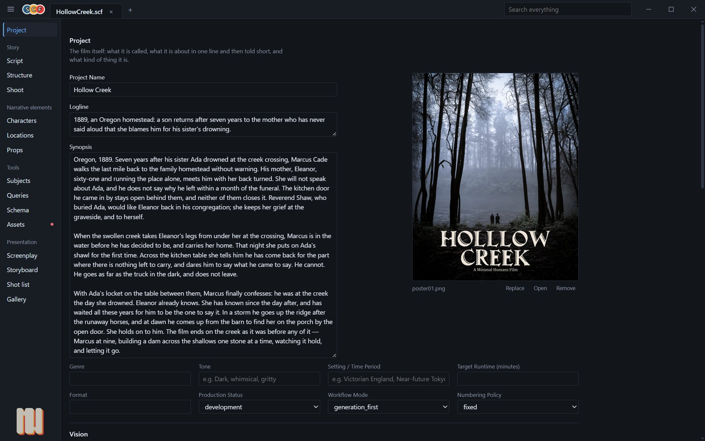

## Finding your way around

Down the left side is the **activity bar**. It's grouped roughly in the
order you'll work:

| Group | Sections | What they're for |
|---|---|---|
| — | Project | The film itself |
| Story | Script, Structure, Shoot | Writing it, shaping it, planning coverage |
| Narrative elements | Characters, Locations, Props | Who and what is in it |
| Tools | Subjects, Queries, Schema, Assets | Looking under the hood |
| Presentation | Screenplay, Storyboard, Shot list, Gallery | Things to print, export or put on a screen |

`Alt+1` to `Alt+0` jump between the ten sections from Script to Assets.
**Search everything** at the top right finds any scene, character, shot
or record by name. Every open `.scf` gets a tab of its own along the top,
like a browser.

The ☰ menu at the top left has the file commands: **New project**,
**Open…**, **Save as…**, **Change asset root folder…** and **Settings**.

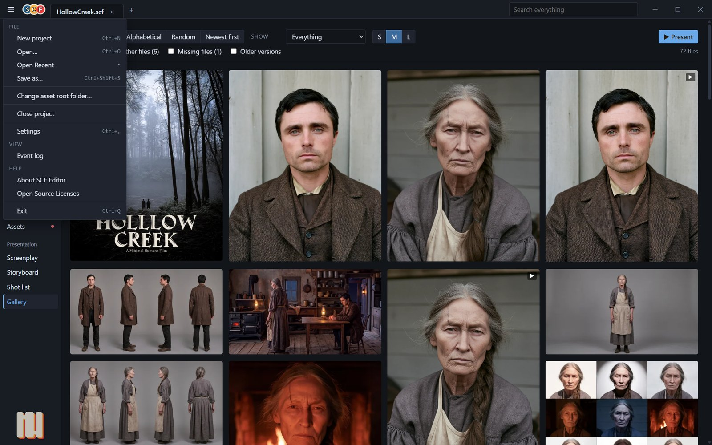

## 1. Set up a project

**☰ → New project** (`Ctrl+N`) asks where to save the `.scf` file and
opens it on the **Project** tab.

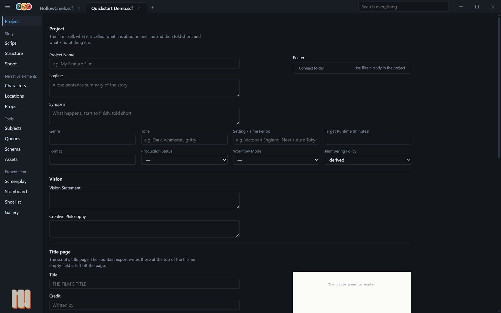

Fill in what you know. Everything saves as you type, and there's no
Save button to forget.

- **Project name, logline, synopsis.** The one-liner and the short
  version. These end up in front of everyone who reads the file,
  including AI assistants, so they're worth a minute.
- **Genre, tone, setting, format, runtime.** Leave them blank if you
  haven't decided yet.
- **Workflow mode** and **numbering policy.** Numbering policy decides
  whether scene numbers are *derived* from the script's order (the
  usual choice while writing) or *fixed* once they've been published to
  a crew.
- **Vision.** The vision statement and creative philosophy: the "why"
  that every later decision gets checked against.
- **Title page.** Title, credit, author, contact. The Screenplay view and
  the Fountain export both use these.
- **Poster.** Choose **Connect folder** to point the project at the
  folder where its images, video and audio live. The editor never copies
  your media. It remembers where each file is, relative to that folder,
  so a project folder can move between machines and still work.

## 2. Import or write a script

Open the **Script** tab. A new project offers two ways in:

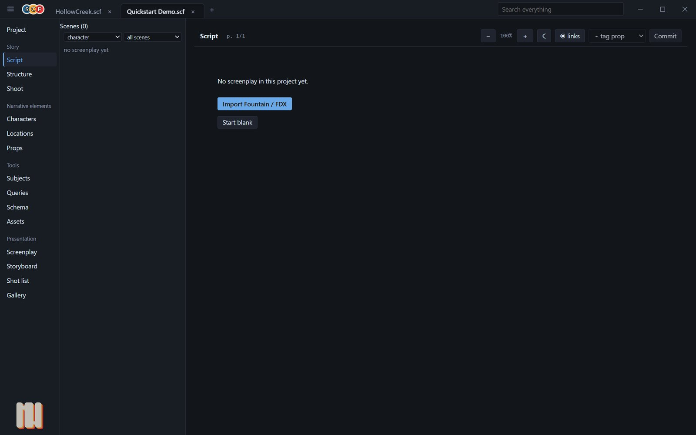

**Start blank** gives you an empty screenplay to write in. **Import
Fountain / FDX** takes a Fountain (`.fountain`, `.txt`) or Final Draft
(`.fdx`) file. Before anything is written, the importer shows you what
it found:

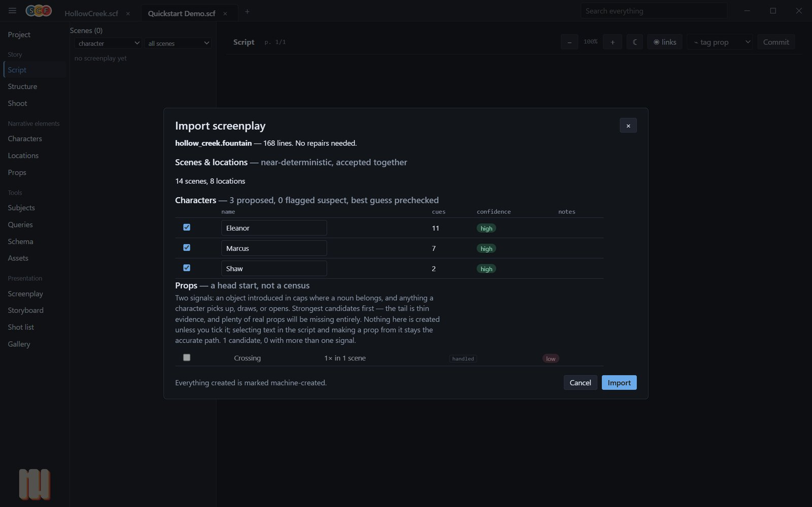

- **Repairs.** Anything that went wrong in conversion, listed before
  and after.
- **Scenes and locations.** These are accepted together.
- **Characters.** Each comes with a confidence score, and the likely
  ones are pre-ticked. Rename them here if the script calls someone
  "MARCUS" and you'd like "Marcus Cade".
- **Props.** A head start, not a full list, so none are ticked. Tick
  the ones you want.

Nothing touches your project until you press **Import**. Your original
file is only read, never written to.

### Working in the script

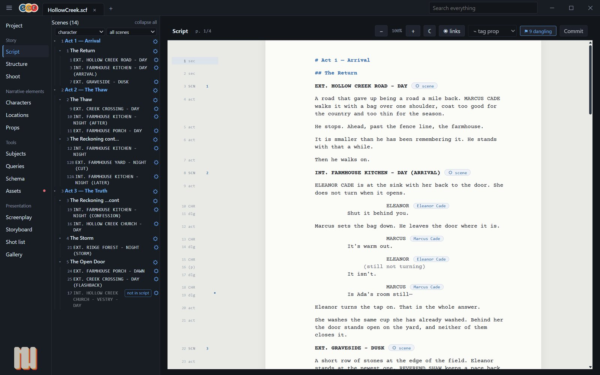

The script is a proper screenplay editor. A few things are worth knowing:

- **Headings become scenes**, and `#` / `##` section lines become acts
  and sequences, when you press **Commit**. Until then you're just
  writing.
- The **scene rail** on the left lists every scene under its act and
  sequence. Click one to jump to it.
- Character cues carry a **chip** (the small blue tag) linking them to
  their character. Click the chip to open that character.
- **Tag prop** links the selected words to a prop, so the prop knows
  where it appears in the script.
- **Links** shows or hides the chips. The moon button switches the page
  between light and dark.

## 3. Structure the script

The **Structure** tab shapes the script into acts and sequences. The
script stays read-only on the left; the structure is on the right.

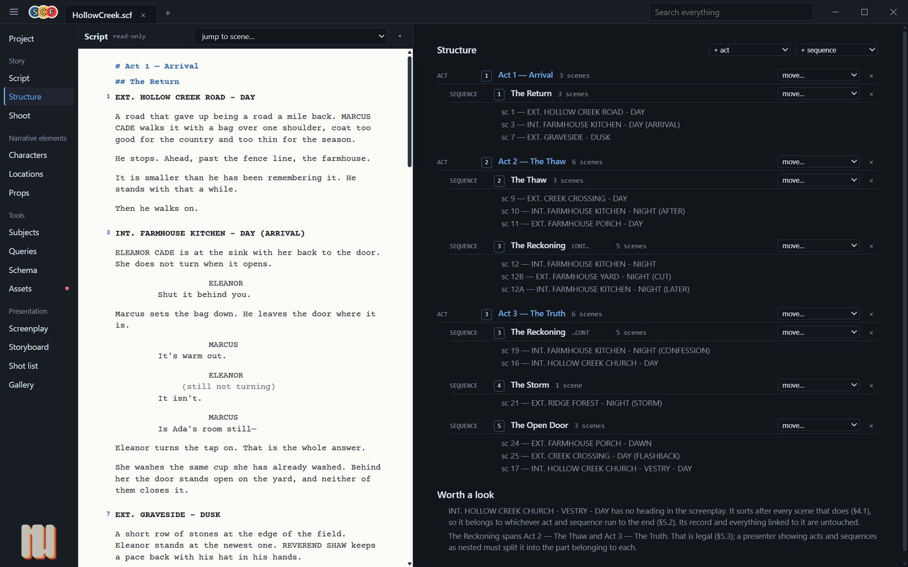

You never drag scenes into acts by hand. Each act or sequence **starts
at a scene** and runs until the next one starts. So there are only three
things to do:

- **+ act / + sequence** starts a new one at the scene you pick.
- **move…** moves where one starts.
- **×** removes one. Its scenes join whatever comes before.

**Worth a look** at the bottom flags anything unusual, such as a scene
that isn't in the screenplay, or a sequence that runs across an act
break. It's information, not an error.

## 4. Plan your shots

**Shoot** is where coverage gets planned: **beats** and **shots**
under each scene, against the structure you just set up.

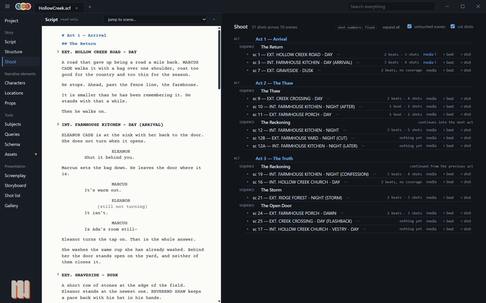

Each row shows how far along a scene is ("2 beats · 3 shots",
"nothing yet"). Open a scene with its ▸ arrow:

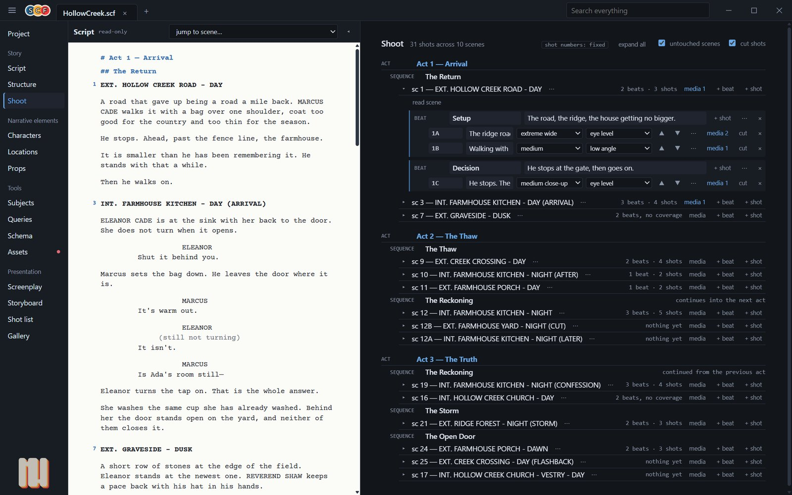

- **+ beat** adds a story beat: a name and one line on what happens.
- **+ shot** adds a shot under a beat. Pick its size and angle from the
  dropdowns and give it a one-line description.
- **▲ ▼** reorder shots. **cut** keeps a shot in the record but leaves it
  out of the storyboard and shot list, unless you ask for cut shots.
- **media** links a shot to its images or clips: a storyboard frame,
  a start frame, a generated take.
- **read scene** brings that scene up in the script on the left.

Shot numbers (1A, 1B, 1C…) follow the project's numbering policy.

## 5. Characters, locations and props

The three **Narrative elements** tabs share a layout: a list on the
left, and a workspace for the selected one on the right, split into
subtabs.

### Characters

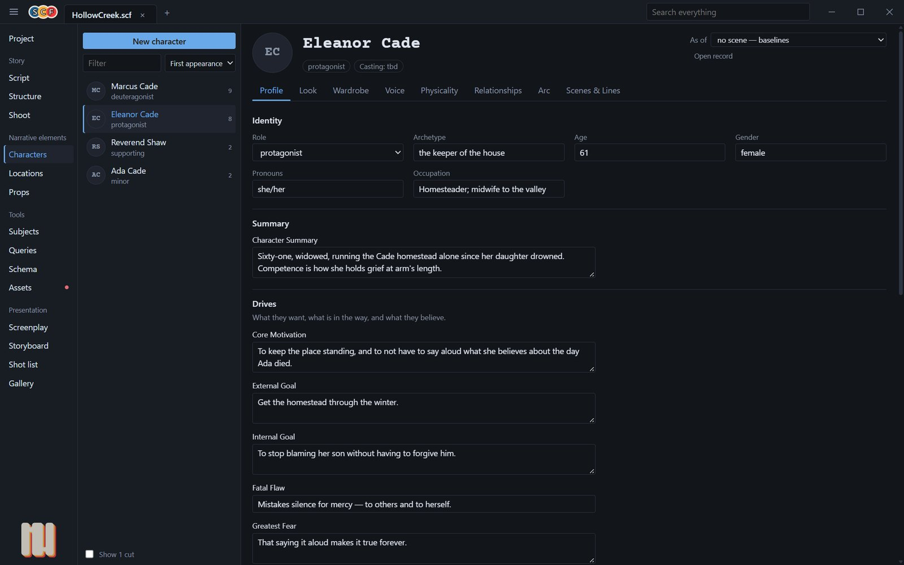

**Profile** covers who they are: role, archetype, age, summary, and their
drives (what they want, what's in the way, what they're afraid of).
The other subtabs are where it gets good:

- **Look.** A reference board. Drop images or video from the project
  folder onto it and say what each one is for. One image is marked
  **This is them**, and you can draw a box over the face so tools know
  exactly where it is.

  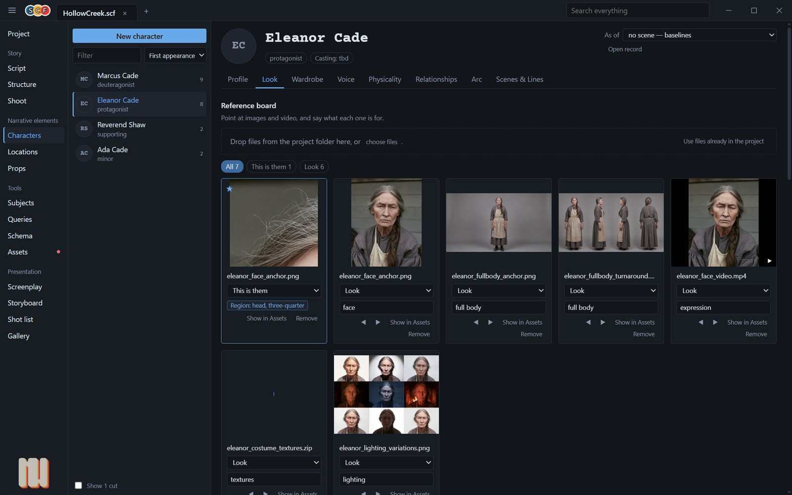

- **Wardrobe.** Costumes, each with its own references and the scenes
  it's worn in, plus how the wardrobe changes through the story.

  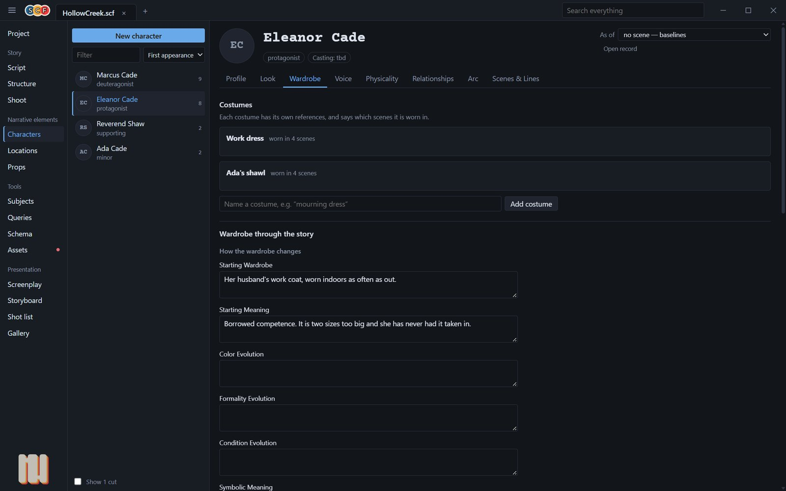

- **Voice** and **Physicality.** How they sound and move, with audio
  and motion references.
- **Relationships.** A map of who they're tied to. Click a line to edit
  that relationship.

  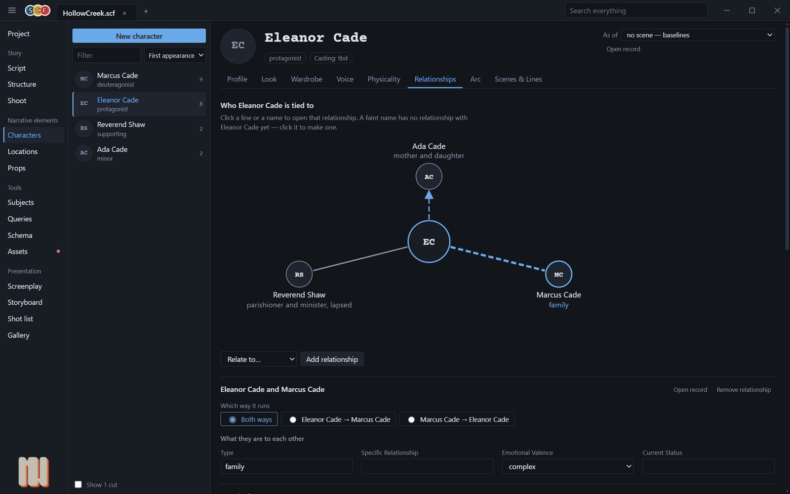

- **Arc.** How they change over the film.
- **Scenes & Lines.** Every scene they're in, whether they speak, what
  they're wearing, and every line they say. "Open in script" jumps to
  the cue.

  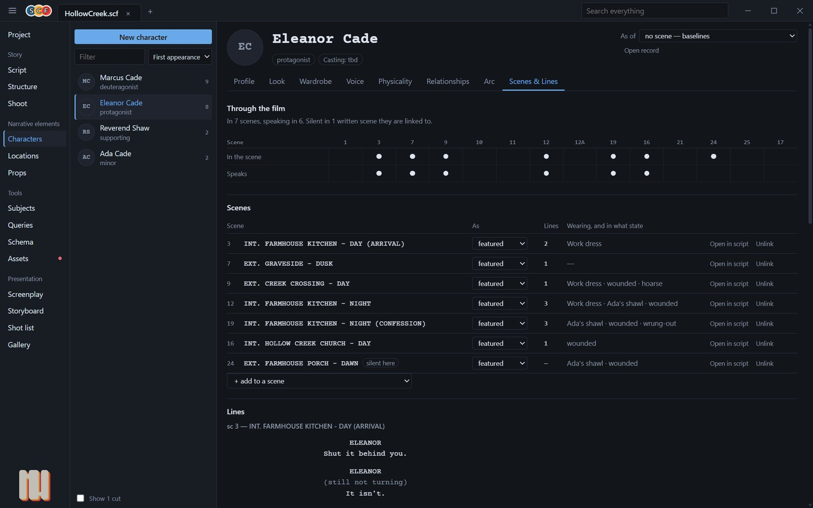

The **As of** control in the header shows the character as they are at
a particular scene: the wound they picked up in scene 9, the shawl they
put on in scene 12. Anything that changes partway through the story
shows up there.

### Locations

Locations have **Profile**, **Look**, **Sound**, **Variants** and
**Scenes**. **Variants** are the other states a place can be in: night,
after the storm, the winter flood. Each scene picks the variant whose
time of day, weather and season fit it best.

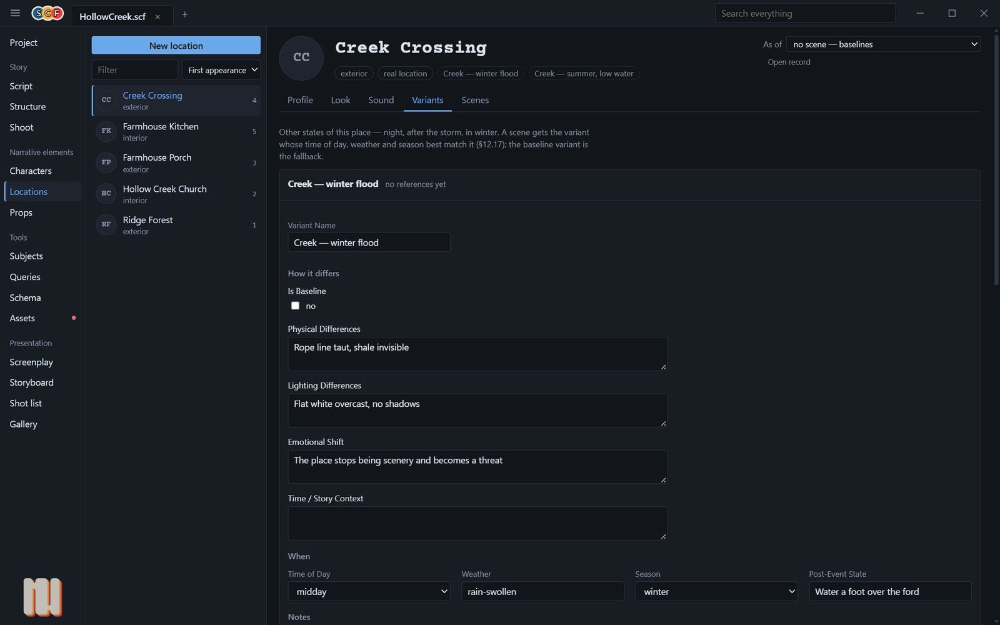

### Props

Props have **Profile**, **Look**, **Variants**, **Through the story**
and **Scenes**. **Through the story** tracks what happens to a prop
across the film: what state it's in, where it is, and who has it.

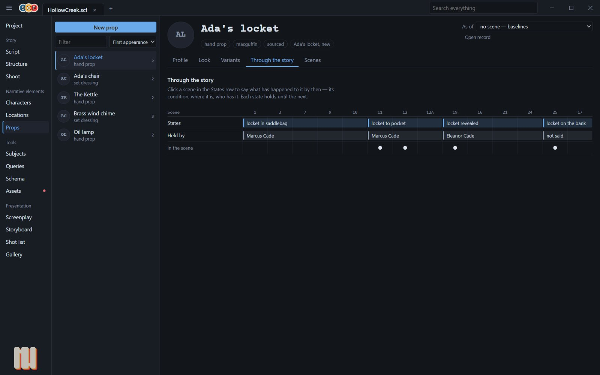

> **Tip.** You don't have to fill everything in. A character with a
> name, a role and one reference image is already far more useful than
> none. Come back and add depth as the film needs it.

## 6. The Tools tabs

You can do a lot without ever opening these, but they're good to know
about.

**Subjects.** Pick any character, location or prop and see everything
that refers to it on one page, with notes on what's still thin.

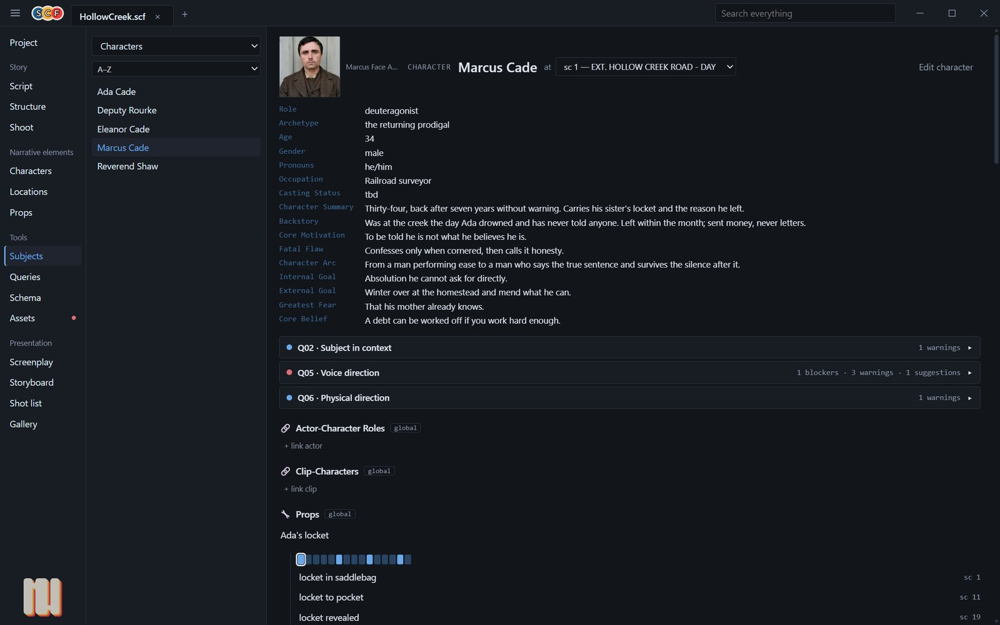

**Queries.** The sixteen standard questions any SCF file can answer,
such as *what does this character sound like here?* or *is this scene
ready to shoot?* Each answer shows as a readable view, as JSON, or as
**Copy as context**: ready to paste into an AI chat.

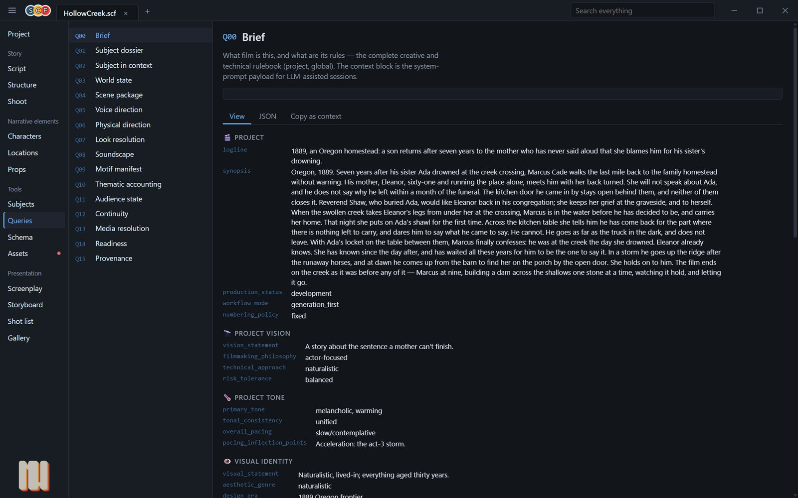

**Schema.** Every type of record in the file, with counts, and a plain
editor for any of them. If a dedicated workspace doesn't have a field
for something, it's here.

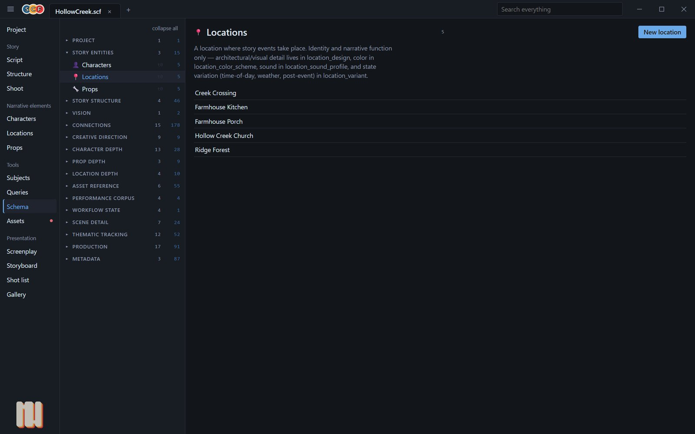

**Assets.** Every media file the project points at, whether each one
can still be found, and what's using it. Use **Add a folder…** and
**Add files…** to bring media in, and the filters at the top (missing,
unreferenced) to tidy up.

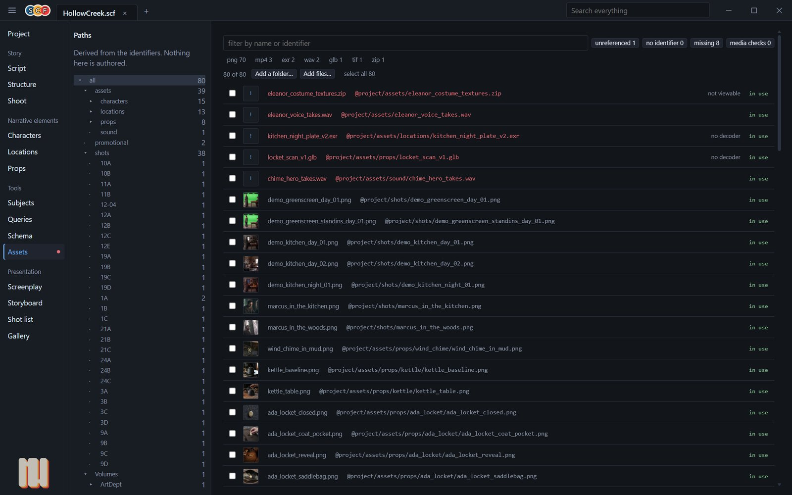

## 7. Presentation and export

The **Presentation** group is read-only: each view is made for sharing.

**Screenplay** lays the committed script out as industry-standard
pages: title page, Courier, scene numbers, (MORE) and (CONT'D). From
here you can **Export FDX**, **Export Fountain**, or **Print / Save
PDF**.

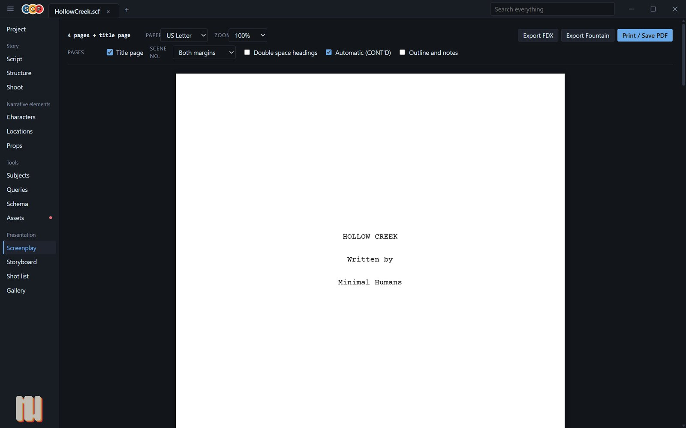

**Storyboard** shows each shot's storyboard frame in order, at the
project's aspect ratio. Switch between **Board** and **Lightbox**, choose
which captions to show, and press **Present** for full-screen
playback, stepped with the arrow keys.

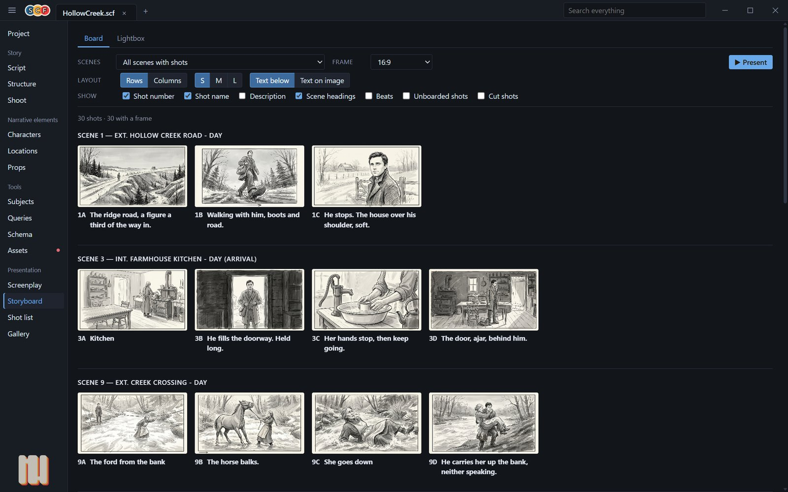

**Shot list** is the printable version of the Shoot tab: frame, shot
code, size, angle, lens, move, action and a Done box. You choose the
columns, paper size and layout, then **Print / Save PDF**.

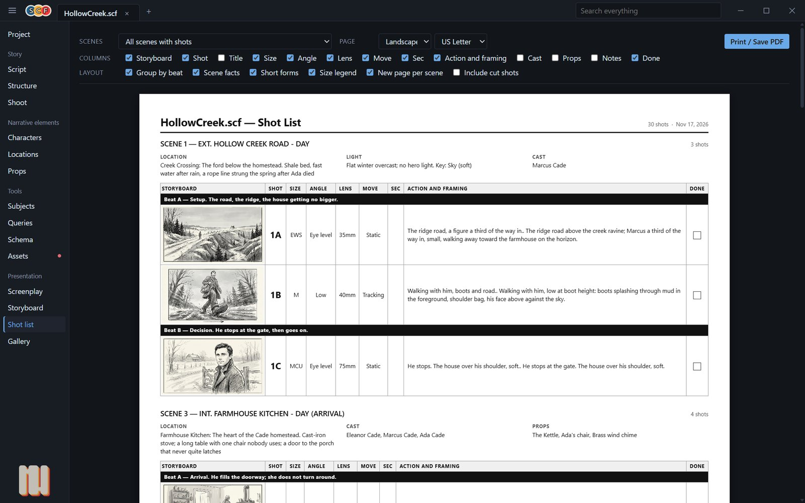

**Gallery** puts every image in the project on one wall, sorted by how
much of the film each one is used in, alphabetically, newest first or
at random. **Present** works here too.

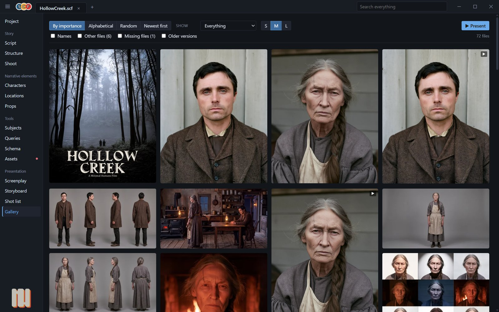

## 8. Using an SCF file with an AI assistant (MCP)

The editor has an **MCP server** built in. MCP is the standard way to
plug tools into an AI assistant. With it connected, an assistant such
as Claude can open your film, answer questions about it, and help write
shot prompts from what's really in the file. It doesn't have to guess.

**To connect Claude Desktop:** ☰ → **Settings** → **Add to Claude
Desktop…**, then quit Claude Desktop completely and reopen it. Closing
the window isn't enough.

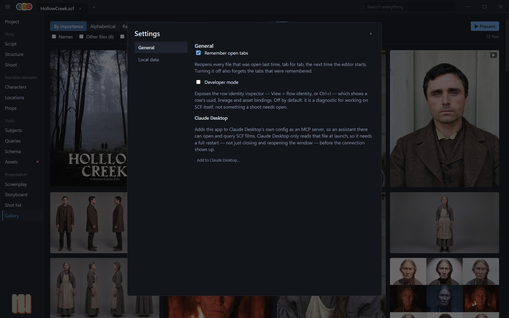

**For Claude Code or other assistants,** point them at the editor's
executable with the argument `mcp`:

```sh
claude mcp add scf -- "%LOCALAPPDATA%\SCF Editor\scf-editor.exe" mcp
```

Then just ask, in plain language:

- *"Open Hollow Creek and give me a brief of the film."*
- *"What is Eleanor wearing in scene 12, and what state is she in?"*
- *"Write an image prompt for shot 9C."*
- *"Which scenes aren't ready to shoot yet, and why?"*

**The assistant and the editor share one live session.** If the
assistant changes something, it shows up in the editor straight away,
marked with who made the change, and the other way round. An
assistant can't quietly rewrite your film. Every change it proposes
comes back as a **plan** first, and nothing happens until you approve
it. The file is also backed up automatically before an assistant's
first change.

The [`scf-mcp` README](https://github.com/MinimalHumans/scf/tree/main/scf-mcp)
has the full list of tools and the setup for other clients.

## Where next

- [What is SCF?](what-is-scf.html) explains the idea behind the format.
- [Authoring guide](authoring-guide.html) covers what to fill in first,
  and what can wait.
- [Glossary](glossary.html) has plain-language definitions for the
  terms you'll run into.

A full editor manual is on its way.
